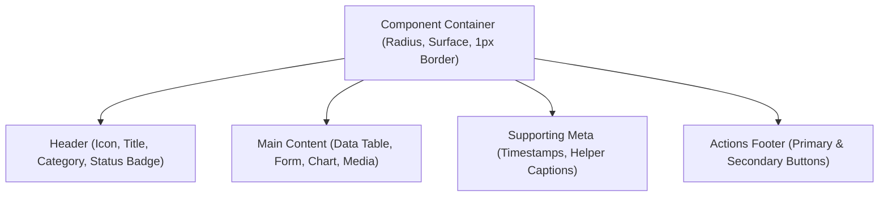

# Professional UI Component Design & Engineering Standards — component-guidelines.md

> **Role & Authority**: Principal UI Component Designer, Senior Frontend Design Engineer, and Design Systems Architect (15+ years of digital product leadership at tier-one technology companies).  
> **Purpose**: The definitive component-level engineering and design specification. Defines how interactive atoms, molecules, and organisms are architected, styled, implemented in React 19 + Tailwind CSS v4, validated for WCAG 2.2 AA accessibility, and integrated into cohesive product surfaces.

---

## Table of Contents
1. [Component Design Philosophy](#1-component-design-philosophy)
2. [Buttons & Action Primitives](#2-buttons--action-primitives)
3. [Cards & Content Containers](#3-cards--content-containers)
4. [Forms & Input Ergonomics](#4-forms--input-ergonomics)
5. [Tables & Enterprise Data Grids](#5-tables--enterprise-data-grids)
6. [Navigation Components](#6-navigation-components)
7. [Segmented Controls vs. Tabs](#7-segmented-controls-vs-tabs)
8. [Dropdowns, Menus & Popovers](#8-dropdowns-menus--popovers)
9. [Modals, Dialogs & Drawers](#9-modals-dialogs--drawers)
10. [Badges, Chips & Status Indicators](#10-badges-chips--status-indicators)
11. [Charts & Data Visualization](#11-charts--data-visualization)
12. [Loading, Empty & Error Components](#12-loading-empty--error-components)
13. [Tooltips & Contextual Help](#13-tooltips--contextual-help)
14. [Component Anatomy & Structural Hierarchy](#14-component-anatomy--structural-hierarchy)
15. [React 19 & TypeScript Implementation Standards](#15-react-19--typescript-implementation-standards)
16. [Component Interaction & Motion Physics](#16-component-interaction--motion-physics)
17. [Component-Level Responsive Adaptations](#17-component-level-responsive-adaptations)
18. [The 11-Point Component Quality Review](#18-the-11-point-component-quality-review)
19. [Integration With Other Design Files](#19-integration-with-other-design-files)

---

## 1. Component Design Philosophy

A UI component is not an isolated piece of graphic design; it is a **functional contract** between the human operator and the underlying software system.

### 1.1. Core Invariants
- **Single Responsibility Principle**: A component must do one specific job exceptionally well. A button executes actions; an input receives data; a card groups related entities.
- **Context-Aware Styling**: Never design a component in isolation on a blank canvas. A button inside a dense table row must have different padding, height, and visual weight than a hero onboarding CTA.
- **State Completeness**: A component is incomplete if it only renders its pristine default state. It must handle all applicable interaction and asynchronous states.
- **Accessibility by Default**: Every component must be keyboard operable, visible to screen readers with semantic roles and accessible names, and contrast-compliant ($4.5:1$ text, $3:1$ controls).
- **Zero Cosmetic Nesting**: Avoid arbitrary wrapping `div`s that bloat the DOM without providing layout or accessible semantics.

---

## 2. Buttons & Action Primitives

Buttons trigger explicit operations. Their visual hierarchy must direct human attention without visual competition.

```
BUTTON HIERARCHY
[ Primary CTA (Solid Accent) ]  ──> Singular high-value action per view
[ Secondary (Surface / 1px Border) ] ──> Alternative paths (Cancel, Export)
[ Tertiary / Ghost (No Fill/Border) ] ──> Low-emphasis actions (Settings, Learn More)
[ Destructive (Red Fill / Red Text) ] ──> Irrevocable operations (Delete, Revoke)
```

### 2.1. Button Taxonomy & Tokens

| Variant | Visual Foundation (Tailwind v4) | Sizing & Padding | Usage Invariant |
| :--- | :--- | :--- | :--- |
| **Primary** | `bg-brand-primary text-white hover:bg-brand-primary/90 active:scale-[0.98]` | `h-9 px-4 text-sm font-medium rounded-lg` | Limit to **one** per visual section. |
| **Secondary** | `bg-surface text-text-primary border border-border-strong hover:bg-neutral-50` | `h-9 px-4 text-sm font-medium rounded-lg` | Standard auxiliary actions (`Filter`, `Export`). |
| **Tertiary / Ghost**| `bg-transparent text-text-secondary hover:text-text-primary hover:bg-neutral-100` | `h-9 px-3 text-sm font-medium rounded-lg` | Subdued utilities (`Dismiss`, `Reset`). |
| **Destructive** | `bg-brand-error text-white hover:bg-brand-error/90 active:scale-[0.98]` | `h-9 px-4 text-sm font-medium rounded-lg` | Irreversible data loss (`Delete Audit`). |
| **Destructive Outline**| `text-brand-error border border-brand-error/30 hover:bg-brand-error/10` | `h-9 px-4 text-sm font-medium rounded-lg` | Secondary destructive triggers (`Remove Tag`). |
| **Icon-Only** | `p-2 text-text-secondary hover:text-text-primary hover:bg-neutral-100` | `size-9 flex items-center justify-center rounded-lg`| **Must** provide `aria-label`. |
| **Floating Action (FAB)**| `fixed bottom-6 right-6 shadow-lg bg-brand-primary text-white` | `h-12 px-5 text-sm font-semibold rounded-full` | High-frequency primary mobile triggers. |

### 2.2. Engineering Rules for Buttons
1. **Preserve Dimensions in Loading State**: When transitioning to `isLoading`, never collapse the button width. Replace text with an inline SVG spinner + "Saving..." while maintaining identical `min-w` or preserving box dimensions.
2. **Accessible Names on Icon-Only Buttons**: `<button aria-label="Close modal"><XIcon className="size-4" /></button>`. Never omit the accessible label.
3. **No Interactive Clickable Divs**: Always render `<button type="button">`. Never `<div onClick={...}>`.

---

## 3. Cards & Content Containers

Cards group related information into distinct spatial surfaces. 

```
+-----------------------------------------------------------------------+
| CARD ANATOMY                                                          |
| [Header] Title: text-base font-semibold    [Badge: Status Pill]       |
|          Subtitle: text-xs text-text-muted                            |
| --------------------------------------------------------------------- |
| [Body]   Key Information / Chart / Metric Data                        |
|          Generous internal padding (p-4 to p-6)                       |
| --------------------------------------------------------------------- |
| [Footer] Auxiliary metadata                [Action: Button / Link]    |
+-----------------------------------------------------------------------+
```

### 3.1. Card Archetypes
- **Informational / Summary Card**: Flat surface (`bg-surface border border-border-subtle rounded-xl p-5`).
- **Interactive / Clickable Card**: Adds hover border brightening (`hover:border-neutral-300 hover:shadow-sm cursor-pointer transition-all`). Entire surface is clickable; child links must avoid nested `<a>` conflicts.
- **KPI Metric Card**: High-contrast numeral (`text-2xl font-bold font-sans tabular-nums`), micro-label above, and contextual delta badge below (`+12.4% vs last week`).
- **Media / Reward Card (Tomo)**: Rounded container (`rounded-2xl overflow-hidden border border-border-subtle`) with $16:9$ or $1:1$ imagery, gradient text scrim, and prominent coin counter.

### 3.2. Card Anti-Patterns
- ❌ **Card-in-Card-in-Card**: Avoid triple-nested cards with compounding borders and shadows. Flatten child containers with whitespace or subtle background wells (`bg-neutral-50 rounded-lg p-3`).
- ❌ **Unjustified Cards**: Do not put every isolated sentence inside a card. Use whitespace for separation unless distinct grouping is functionally required.

---

## 4. Forms & Input Ergonomics

Forms are high-friction interaction barriers. Every input must be self-explanatory, resilient to errors, and effortless to operate.

```
FORM FIELD ANATOMY
[ Label ] Store Code (optional)                 [ Helper Tooltip (?) ]
+--------------------------------------------------------------------+
| [Icon]  Enter 4-character code (e.g. ST01)             [Clear (X)] |
+--------------------------------------------------------------------+
[ Inline Error ] ⚠ Store code must begin with 'ST' followed by 2 digits.
```

### 4.1. Input Specifications

| Input Component | Height | Typography | Focus State |
| :--- | :--- | :--- | :--- |
| **Text / Search Input** | `38px` (`h-[38px]`) | `text-sm placeholder:text-text-muted` | `focus:border-brand-primary focus:ring-2 focus:ring-brand-primary/20` |
| **Select / Dropdown** | `38px` (`h-[38px]`) | `text-sm text-text-primary` | Same as text input; chevron icon right-aligned. |
| **Textarea** | Min `96px` (`min-h-24`) | `text-sm leading-relaxed` | Same; vertical resize only (`resize-y`). |
| **Checkbox** | `18px` (`size-4.5`) | `accent-brand-primary rounded` | High-contrast checkmark; clickable adjacent label. |
| **Radio Button** | `18px` (`size-4.5`) | `accent-brand-primary rounded-full` | Single mutual exclusion; grouped in `<fieldset>`. |
| **Toggle Switch** | `24px` height, `44px` width | Smooth slide transition (`translate-x`) | `role="switch"` with `aria-checked="true/false"`. |

### 4.2. Form Validation & UX Rules
1. **Never Placeholder-Only**: A form field must always have a visible, persistent `<label>`. Placeholders vanish on typing and must only provide format examples (e.g., `user@domain.com`).
2. **Inline Validation on Blur**: Validate when the user leaves the field (`onBlur`), not on the first keystroke. Clear the error immediately once typing becomes valid.
3. **Preserve Data on Failure**: Never clear inputs when a server error occurs. Keep valid fields populated.
4. **Accessible Error Binding**: Link the error message to the input using `aria-describedby="error-id"` and mark the field with `aria-invalid="true"`.

---

## 5. Tables & Enterprise Data Grids

Tables are the computational backbone of enterprise applications. They require surgical alignment, high information density, and rock-solid stability.

```
ENTERPRISE TABLE ARCHITECTURE
+----------------------------------------------------------------------------------------------------+
| [Search articles...]  [Filter: All Discrepancies v]  [Export CSV]                     [1-50 of 420] |
+----------------------------------------------------------------------------------------------------+
| [ ] | SKU / ARTICLE (Left)  | CATEGORY  | BOOK STOCK (Right) | PHYSICAL (Right) | NET DIFF (Right) |
+----------------------------------------------------------------------------------------------------+
| [x] | RFID-9821-XL          | Apparel   |                120 |              117 |       -3 (Red)   |
| [ ] | RFID-9822-M           | Footwear  |                 45 |               45 |        0 (Muted) |
| [ ] | RFID-9823-S           | Footwear  |                 10 |               12 |       +2 (Green) |
+----------------------------------------------------------------------------------------------------+
| SUMMARY: Total Counted: 174 Articles | Net Difference: -1 Units                                     |
+----------------------------------------------------------------------------------------------------+
```

### 5.1. Table Alignment & Density Rules
- **Text Columns**: Left-aligned (`text-left`).
- **Numeric & Monetary Columns**: Right-aligned (`text-right`) with `tabular-nums` so decimal points and digits line up perfectly.
- **Status Pills, Dates, Checkboxes**: Center-aligned (`text-center`).
- **Row Density Tiers**:
  - *Compact Operational*: `py-2 px-3 text-xs` (POS triage, Cycle Count discrepancy lists).
  - *Standard*: `py-3 px-4 text-sm` (Standard business records, inventory overviews).
  - *Spacious*: `py-4 px-5 text-sm` (Consumer transaction histories, order tracking).

### 5.2. Mandatory Table Features
1. **Sticky Header**: `thead` must stick during vertical scrolling (`sticky top-0 bg-surface z-10 border-b border-border-strong`).
2. **Row Hover Shading**: `hover:bg-neutral-50/80 transition-colors` so operators can track wide horizontal data across monitors without losing their place.
3. **Summary Rows**: Distinct sticky or fixed footer row displaying totals (`@QTY`, `@HU_VALIDATED_QTY`), styled with `font-semibold bg-neutral-50/50`.
4. **Performance & Virtualization**: For datasets $> 200$ rows, employ windowed virtualization (e.g., TanStack Virtual) to guarantee 60fps scrolling with zero DOM lag.

---

## 6. Navigation Components

Navigation orients the user and preserves context.

### 6.1. Navigation Taxonomy
- **Top Navigation Bar**: Global branding, global search (`⌘K`), environment indicators, notifications, and user avatar. Height: `56px`–`64px`.
- **Sidebar Rail (Desktop)**: Persistent primary domain navigation.
  - *Expanded*: `240px`–`260px` with icons and text labels.
  - *Collapsed Rail*: `64px` icon-only rail with tooltips on hover.
  - *Active Item*: High-contrast background tint (`bg-neutral-100 font-semibold text-text-primary`) and 2px left brand indicator.
- **Breadcrumbs**: Displayed when hierarchical depth $> 1$ (`Stores / Shibuya Flagship / Audits / #8941`). All ancestors are links; the current active page is plain text.
- **Bottom Navigation Bar (Mobile)**: Fixed bottom thumb-zone bar ($h=56\text{px}$–$64\text{px}$) holding 3–5 primary destinations (e.g., Tomo: *Adventures | Map | Profile*).

---

## 7. Segmented Controls vs. Tabs

These two components are frequently confused but serve completely different interaction models:

```
SEGMENTED CONTROL (Filters / Mutually Exclusive Option within View)
+-------------------------------------------------------------------+
| [  Daily (Active Pill)  ] [      Weekly      ] [      Monthly     ] |
+-------------------------------------------------------------------+
- Mutually exclusive view modifier (does NOT change URL or major page context)
- Compact, pill-shaped or sunken background well
- Instant transition without page reload

TABS (Major Content Switching / Page Sections)
+-------------------------------------------------------------------+
| Overview             Discrepancies (12)            Audit History  |
| ══════════ (Active)                                               |
+-------------------------------------------------------------------+
- Switches entire content panels or sub-routes
- Underline indicator or prominent tab header
- Can sync with URL query parameters (?tab=discrepancies)
```

### 7.1. Decision Matrix
- Use **Segmented Controls** for: Timeframes (`Day | Week | Month`), view modes (`Grid | List`), or unit toggles (`Imperial | Metric`). Max 2–4 options.
- Use **Tabs** for: Dividing complex entity details (`General | Permissions | Activity | Webhooks`).

---

## 8. Dropdowns, Menus & Popovers

Flyout overlays must be predictable, resilient to viewport edges, and keyboard navigable.

### 8.1. Dropdown Invariants
- **Trigger Clarity**: Triggers must display a downward chevron (`size-4 transition-transform duration-200`) that rotates $180^\circ$ when open.
- **Edge Collision Detection**: Dropdowns must positionally flip (top/bottom/left/right) so they never clip beyond the viewport edge.
- **Dismissal Physics**: Must close immediately upon:
  1. Clicking outside the overlay.
  2. Pressing the `Escape` key.
  3. Selecting a valid option.
- **Focus Restoration**: When the dropdown closes, keyboard focus must return cleanly to the trigger button.

---

## 9. Modals, Dialogs & Drawers

Overlays interrupt the user's flow and demand focused attention. Use them judiciously.

```
+-----------------------------------------------------------------------+
| BACKDROP OVERLAY: bg-black/40 backdrop-blur-sm                        |
|                                                                       |
|      +---------------------------------------------------------+      |
|      | MODAL DIALOG (max-w-md bg-surface rounded-2xl shadow-xl)|      |
|      | [Title: Confirm Audit Deletion]               [Close X] |      |
|      | ------------------------------------------------------- |      |
|      | [Body: Are you sure? This will remove 42 tags...]       |      |
|      | ------------------------------------------------------- |      |
|      | [Actions: Cancel (Secondary)]  [Delete Audit (Red CTA)] |      |
|      +---------------------------------------------------------+      |
+-----------------------------------------------------------------------+
```

### 9.1. Dialog Types & Rules
- **Confirmation Dialogs**: Small (`max-w-md`), explicit title, concise consequence summary, two buttons: `Cancel` (secondary, safe) and `Confirm` (primary or destructive).
- **Side Drawers (Sheets)**: Slide out from the right (`w-[400px]`–`w-[540px]`) for detail inspectors and configuration forms, preserving the background table canvas.
- **Mobile Bottom Sheets**: On viewports $<640\text{px}$, all desktop dialogs and filters should render as bottom sheets with a top drag handle (`w-12 h-1.5 bg-neutral-300 rounded-full mx-auto my-3`).
- **Focus Trap Invariant**: Tab navigation must cycle exclusively within the active dialog. Users must not be able to tab to elements hidden behind the backdrop.

---

## 10. Badges, Chips & Status Indicators

Badges provide high-density status communication. They must be visually restrained.

### 10.1. Semantic Status Token Rules
- **Never Rely on Color Alone**: Always pair color with an explicit text label or icon:
  - *Success*: Green dot/background + "Verified" or "Counted".
  - *Error*: Red dot/background + "Discrepant (-3)".
  - *Warning*: Amber dot/background + "Pending Review".
  - *Neutral*: Gray background + "Draft" or "Archived".
- **Visual Restraint**: Use soft alpha backgrounds with saturated text (`bg-emerald-50 text-emerald-700 border border-emerald-200/60`). Avoid harsh, fully saturated neon background fills.
- **Filter Chips**: Interactive chips must have a clear `(X)` remove icon and accessible button behavior.

---

## 11. Charts & Data Visualization

Charts transform raw numbers into operational insights. They are functional instruments, not decorative artwork.

### 11.1. Chart Selection Guidance
- **Line Charts**: For trends over continuous time (e.g., daily sales over 30 days). Max 3–4 series per chart.
- **Bar Charts**: For discrete category comparisons (e.g., discrepancies per store location).
- **Area Charts**: For volume over time where total magnitude matters (e.g., cumulative scanned articles).
- **Donut Charts**: For proportional parts of a whole ($100\%$). Max 5 slices; sort slices by magnitude. Never use 3D pie charts.
- **Sparklines**: Ultra-compact inline trend lines without axes, embedded directly in KPI cards or table rows.

### 11.2. Visualization Hygiene
- **Readable Axes**: Limit axis ticks to 4–6 intervals. Use formatted labels (`$12K`, not `$12000.00`).
- **Rich Hover Tooltips**: Display exact dates, quantities, and percentage deltas on hover with a crisp floating card (`shadow-md border border-border-subtle`).
- **Empty Datasets**: When no data exists, render an informative empty state inside the chart container rather than a broken, zeroed-out coordinate grid.

---

## 12. Loading, Empty & Error Components

Asynchronous states dictate whether software feels broken or resilient under network strain.

### 12.1. Skeletons vs. Spinners
- **Content Skeletons**: Use when the incoming component geometry is known (cards, tables, profiles). The skeleton pulses gently (`animate-pulse bg-neutral-200/80 rounded`) matching exact heading and text line dimensions.
- **Inline Spinners**: Use inside buttons or next to saving indicators for quick operations ($<1\text{s}$).
- **Empty States**: Never leave a blank white area. Provide:
  1. A clear icon or illustration.
  2. A concise heading: "No discrepancies found".
  3. A helpful explanation: "All scanned RFID tags match book stock."
  4. An action button: `[Run Fresh Audit]`.

---

## 13. Tooltips & Contextual Help

Tooltips provide supplementary guidance for secondary metadata.

### 13.1. Tooltip Rules
- **Supplementary Only**: Never hide primary instructions, error explanations, or essential labels inside tooltips.
- **300ms Intentional Delay**: Tooltips must not pop up instantly on casual pointer movement; enforce a 300ms hover delay.
- **Touch-Friendly Alternatives**: On mobile touchscreens where hover is impossible, replace tooltips with inline helper text or an accessible `(?)` tap trigger opening a micro-sheet.

---

## 14. Component Anatomy & Structural Hierarchy

Every complex component follows a standard structural anatomy:



Maintaining this standard anatomy across cards, dialogs, drawers, and panels guarantees that users intuitively know where to look for status (top right), content (center), and actions (bottom right).

---

## 15. React 19 & TypeScript Implementation Standards

Components in this codebase are engineered with React 19, TypeScript 5.7, and Tailwind CSS v4.

### 15.1. Component Code Standards
1. **Explicit TypeScript Props**: Define all props via `interface` or `type`, extending native HTML attributes where appropriate (`React.ButtonHTMLAttributes<HTMLButtonElement>`).
2. **Default Exports**: Export all primary components as default exports per project conventions.
3. **Double Quotes for Strings**: Use double quotes for strings containing apostrophes (`"We're here to help"`), or escape single quotes properly.
4. **No Invalid Interactive Nesting**: Never nest a `<button>` inside an `<a>` or an `<input>` inside a `<button>`. This triggers hydration crashes and destroys keyboard focus.
5. **State Hoisting**: Keep presentational UI components pure and stateless where practical, receiving state and callbacks via props.

---

## 16. Component Interaction & Motion Physics

Motion must feel organic, purposeful, and instantaneous.

### 16.1. Physics & Timing Scales
- **Micro-Interactions (Hover, Button Press)**: $100\text{ms}$–$150\text{ms}$ duration with `ease-out` (`transition-all duration-150 ease-out`).
- **Overlays & Drawers (Enter / Exit)**: $200\text{ms}$–$300\text{ms}$ with cubic-bezier deceleration (`ease-out` on enter, `ease-in` on exit).
- **Reduced Motion Invariant**: Always support vestibular accessibility:
  ```css
  @media (prefers-reduced-motion: reduce) {
    *, ::before, ::after {
      animation-duration: 0.01ms !important;
      transition-duration: 0.01ms !important;
    }
  }
  ```

---

## 17. Component-Level Responsive Adaptations

A responsive page does not guarantee responsive components. Each component must be tested in isolation:

| Component | Desktop ($\ge 1024\text{px}$) | Mobile ($< 640\text{px}$) |
| :--- | :--- | :--- |
| **Table** | Full multi-column data grid with sticky header | Horizontal card stack with primary KPI and expanding details |
| **Modal** | Centered floating dialog ($512\text{px}$ max width) | Anchored bottom sheet with drag handle |
| **Button Group**| Horizontal cluster with right-aligned primary CTA | Full-width vertical stack (primary on top) |
| **Segmented Control**| Horizontal row with fixed segments | Scrollable pill strip or compact native select |
| **Navigation**| Persistent sidebar or top desktop navigation bar | Fixed bottom thumb bar ($44\text{px}$–$56\text{px}$) |

---

## 18. The 11-Point Component Quality Review

Before committing any new or refactored UI component, evaluate it against this checklist:

- [ ] **1. Singular Purpose**: Does the component have one clear, well-defined responsibility?
- [ ] **2. Design Token Alignment**: Are all colors, typography, borders, and radii drawn from the design system?
- [ ] **3. State Completeness**: Are default, hover, active, focus-visible, disabled, and loading states handled?
- [ ] **4. Keyboard Operability**: Can the component be navigated and operated via `Tab`, `Enter`, `Space`, and `Escape`?
- [ ] **5. Screen Reader Readiness**: Are semantic HTML elements, accessible names, and ARIA attributes in place?
- [ ] **6. Touch Target Compliance**: Is the physical hit area $\ge 44 \times 44\text{px}$ on touch devices?
- [ ] **7. Text Overflow Resilience**: Does the component gracefully handle unexpectedly long labels (`truncate` or `break-words`)?
- [ ] **8. Empty & Error Grace**: Does it degrade cleanly when data is empty or an error occurs?
- [ ] **9. Zero Layout Shift**: Does it declare dimensions or skeletons to maintain $\text{CLS}=0$?
- [ ] **10. Motion Accessibility**: Are all transitions compliant with `prefers-reduced-motion`?
- [ ] **11. Professional Finish**: Does the component look cultivated, polished, and worthy of a tier-one product?

---

## 19. Integration With Other Design Files

This component guide operates as the tactical execution layer of the design architecture:
- **`AGENTS.md`**: Master operating rules, persona, and technical environment.
- **`design-philosophy.md`**: Foundational design thinking, cognitive laws, and aesthetic judgment.
- **`ui-design-system.md`**: Tokenized foundations (colors, typography, spacing, elevation).
- **`ux-principles.md`**: Interaction psychology, state machines, and accessibility requirements.
- **`layout-patterns.md`**: Page composition, spatial grids, and responsive transformations.
- **`component-guidelines.md` (This file)**: The binding authority on atomic and molecular UI component construction.

> **Final Operating Principle**: Every component must feel like a carefully engineered part of a unified product, never a disconnected piece of UI.
