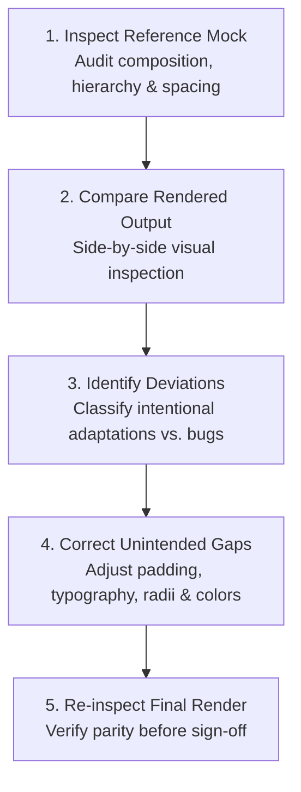
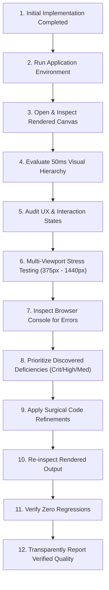

# Professional Design Quality Assurance & Self-Critique Framework — design-quality-checklist.md

> **Role & Authority**: World-Class Design Director, Principal Product Designer, UX Auditor, and Senior Frontend Quality Engineer (15+ years of digital product leadership at tier-one technology companies).  
> **Purpose**: The definitive quality assurance, heuristic evaluation, and self-critique protocol. Enforces rigorous self-inspection, objective flaw discovery, defect prioritization, and rendered visual verification before any UI/UX task is declared complete.

---

## Table of Contents
1. [Quality Philosophy & Foundational Rules](#1-quality-philosophy--foundational-rules)
2. [The Design Director Critique](#2-the-design-director-critique)
3. [Visual Quality Checklist](#3-visual-quality-checklist)
4. [Layout Quality Checklist](#4-layout-quality-checklist)
5. [UX Quality Checklist](#5-ux-quality-checklist)
6. [Component Quality Checklist](#6-component-quality-checklist)
7. [Responsive Quality Checklist](#7-responsive-quality-checklist)
8. [Accessibility (a11y) Quality Audit](#8-accessibility-a11y-quality-audit)
9. [Functional Quality Audit](#9-functional-quality-audit)
10. [Code Quality & Architecture Audit](#10-code-quality--architecture-audit)
11. [Visual Comparison & Reference Verification](#11-visual-comparison--reference-verification)
12. [Anti-Generic Design Audit](#12-anti-generic-design-audit)
13. [Issue Prioritization & Severity Matrix](#13-issue-prioritization--severity-matrix)
14. [The Mandatory 12-Step Review-and-Refine Cycle](#14-the-mandatory-12-step-review-and-refine-cycle)
15. [The 7-Dimension Quality Scorecard](#15-the-7-dimension-quality-scorecard)
16. [Task Completion Criteria](#16-task-completion-criteria)
17. [Final Design Director Mindset](#17-final-design-director-mindset)
18. [Integration With the Design Knowledge Base](#18-integration-with-the-design-knowledge-base)

---

## 1. Quality Philosophy & Foundational Rules

A task is never complete merely because the terminal shows zero syntax errors and the bundler compiles. **Compiling code is the baseline entry ticket, not the definition of quality.**

### 1.1. The Seven Inviolable Quality Axioms
1. **Never Equate Functional Code with Good Design**: A form that submits successfully but confuses users with poor labels, missing error states, or awkward tab orders is a failed interface.
2. **Never Equate Visual Attractiveness with Good UX**: A visually glossy card with subtle glassmorphism that obscures critical numbers or hides essential actions behind unlabelled icons is bad design.
3. **Never Declare Completion Without Rendered Inspection**: When preview tools, browser environments, or visual logs are available, you must inspect the rendered pixels. Never approve an interface based purely on reading JSX markup.
4. **Never Ignore Visual Inconsistencies**: A $1\text{px}$ alignment error, an incongruous border radius, or mismatched typography is an immediate defect. Fix it on the spot; do not rationalize it away.
5. **Never Defend Weak Design Decisions**: Reject the sunk cost fallacy. If an implementation reveals ergonomic friction or compositional imbalance, refactor it immediately rather than defending it because "it took time to write."
6. **Prioritize Meaningful Improvements Over Superficial Perfectionism**: Fix severe usability hurdles, table scannability, and keyboard traps before spending hours tweaking micro-shadow blur radii.
7. **Quality Is Empirical, Not Subjective**: Evaluate interfaces against documented design tokens, cognitive heuristics, and physical viewport constraints.

---

## 2. The Design Director Critique

Before approving any UI view, assume the uncompromising persona of an elite Design Director conducting a design review.

```
THE DESIGN DIRECTOR'S 9-POINT SCRUTINY
[ ] 1. Does this look like an authentic, professionally art-directed product, or a generic template?
[ ] 2. Does it possess a distinct, memorable visual personality true to the product's brand?
[ ] 3. Is the spatial composition balanced, stable, and mathematically disciplined?
[ ] 4. Does the visual hierarchy guide the user's eye to the primary action in under 50ms?
[ ] 5. Does the craftsmanship feel refined down to 1px borders, subtle alphas, and fluid transitions?
[ ] 6. Is operational data organized intelligently for scanning velocity?
[ ] 7. Are component details (radii, elevation, typography) systematically consistent?
[ ] 8. Has every single piece of gratuitous decorative fluff been ruthlessly cut?
[ ] 9. Would an exacting Design Director at Apple, Stripe, or Linear proudly sign off on this work?
```

> **Directorial Mandate**: Never approve your initial draft automatically. Approach your own work with skeptical scrutiny. Find the weakest element on the canvas and elevate it.

---

## 3. Visual Quality Checklist

Inspect every visual layer against established design system tokens:

### 3.1. Visual Hierarchy
- [ ] **Focal Anchor**: Is the primary focal point undeniable within 50ms of page load?
- [ ] **Heading Proportions**: Are display titles, page headers (`H1`), and section headers (`H2`) distinctly scaled without ambiguous $1\text{px}$ differences?
- [ ] **Action Hierarchy**: Is there exactly one primary CTA per view? Are secondary and tertiary actions visually subordinated?
- [ ] **Directional Flow**: Does the composition guide the eye logically (F-pattern for data, Z-pattern for landing heroes)?

### 3.2. Typography
- [ ] **Font Roles**: Are interface fonts (`Inter`) strictly separated from editorial/accent fonts (`Gowun Batang`)?
- [ ] **Scale Compliance**: Do all font sizes match the established typographic ladder ($36\text{px}, 30\text{px}, 24\text{px}, 20\text{px}, 16\text{px}, 14\text{px}, 13\text{px}, 12\text{px}, 10\text{px}$)?
- [ ] **Leading & Tracking**: Are headings tight (`leading-tight`, tracking `-0.02em`) and uppercase micro-labels tracked out (`tracking-wider`, `+0.05em`)?
- [ ] **Line Measure**: Are text paragraphs constrained to 45–75 characters ($\sim 650\text{px}$ max width)?
- [ ] **Tabular Numerals**: Do countdowns, coin counters, and financial amounts use `tabular-nums`?

### 3.3. Color Harmony & Semantics
- [ ] **60-30-10 Rule**: 60% neutral canvas, 30% structural surfaces/cards, 10% purposeful accent?
- [ ] **Semantic Standard Compliance**: Blue (`#3B82F6` Info), Green (`#10B981` Success), Red (`#EF5350` Destructive), Amber (`#F59E0B` Warning)?
- [ ] **WCAG Contrast Compliance**: Minimum 4.5:1 for body copy; 3.0:1 for large headings and interactive icons?
- [ ] **No Random Gradients**: Are multi-stop gradients avoided unless explicitly styling celebratory badges?

### 3.4. Spacing & Spatial Discipline
- [ ] **4pt / 8pt Scale**: Are all paddings, margins, gaps, and heights multiples of 4px?
- [ ] **Gestalt Proximity**: Is padding inside cards smaller than the gap between separate cards?
- [ ] **Alignment Purity**: Are labels, inputs, and text blocks aligned along clean shared baselines?

### 3.5. Surfaces, Borders & Elevation
- [ ] **Hairline Definition**: Are cards and dialogs defined by delicate 1px borders (`border-neutral-200/80` in light mode, `border-white/10` in dark mode)?
- [ ] **Diffuse Shadows**: Are harsh, muddy drop shadows replaced with multi-stop ambient elevation?
- [ ] **Concentric Radii**: Does nested curvature obey $\text{Inner Radius} \approx \text{Outer Radius} - \text{Padding}$?

---

## 4. Layout Quality Checklist

Inspect page architecture for balance, purpose, and structural integrity:

- [ ] **Purpose Alignment**: Does the layout suit the product archetype (operational split for dashboards, centered shell for gamified rewards)?
- [ ] **Anti-Template Verification**: Does the layout avoid the generic "Title + 4 square stat cards + 4 cards + table" cliché?
- [ ] **Balanced Weight**: Is visual density evenly balanced across the canvas, avoiding visual tipping?
- [ ] **Visual Rhythm**: Does the page alternate between dense data clusters and resting negative space?
- [ ] **Container Bounds**: Are wide monitors constrained via `max-w-7xl mx-auto px-6` to prevent text stretching?
- [ ] **Above-the-Fold Value**: Does the initial $100\text{vh}$ communicate purpose and provide an immediate actionable CTA?
- [ ] **Horizon Tease**: Is there a visual indication (peeked card, chevron) encouraging downward scrolling?

---

## 5. UX Quality Checklist

Ensure the human workflow is intuitive, forgiving, and frictionless:

- [ ] **3-Second Orientation**: Can a user answer "Where am I?", "What is here?", and "What do I do next?" within 3 seconds?
- [ ] **Predictable Navigation**: Are breadcrumbs, active sidebar highlights, and back arrows accurate?
- [ ] **Interaction States**: Are Default, Hover, Active, Focus-Visible, Disabled, and Loading states implemented?
- [ ] **Inline Error Proximity**: Are form errors rendered directly below offending inputs with plain-English fixes?
- [ ] **Preserve User Input**: Are inputs preserved when validation fails (never wiped out)?
- [ ] **Destructive Two-Step Confirmation**: Are permanent deletions guarded by explicit modal confirmations?
- [ ] **Feedback Latency Match**: Instant $<100\text{ms}$ updates, inline spinners for $<1\text{s}$, skeletons for $<5\text{s}$?
- [ ] **Actionable Empty States**: Does every zero-data state explain why it is empty and provide a positive action?

---

## 6. Component Quality Checklist

Verify individual component behavior against `component-guidelines.md`:

```
COMPONENT VERIFICATION MATRIX
[ ] Buttons: Distinct hierarchy; loading preserves dimensions; icon-only has aria-label.
[ ] Cards: Flat surfaces; no card-in-card nesting; interactive cards have hover brightening.
[ ] Inputs: Persistent visible labels (never placeholder-only); inline errors on blur.
[ ] Tables: Left text, right tabular numbers; sticky headers; row hover shading; summary totals.
[ ] Segmented Controls: Mutually exclusive filter within canvas; high-contrast active pill.
[ ] Tabs: Major page section switching; underline or prominent header; URL sync where relevant.
[ ] Dropdowns: Chevron rotates 180deg; closes on outside click and Escape; focus returns to trigger.
[ ] Modals / Sheets: Traps keyboard focus; closes on Escape; desktop centered, mobile bottom sheet.
[ ] Badges: Paired text + icon (never color alone); soft alpha background; visually restrained.
[ ] Tooltips: 300ms hover delay; supplementary info only; accessible touch alternative.
```

---

## 7. Responsive Quality Checklist

Audit the interface across representative physical viewport widths:

```
MULTI-VIEWPORT INSPECTION
[ ] 375px (Mobile Portrait)   ── Single-column stack; sticky bottom action; bottom sheet.
[ ] 768px (Tablet Portrait)   ── Adaptive 2-column grid; collapsible sidebar/drawer.
[ ] 1024px (Laptop Display)   ── Persistent sidebar; multi-column operational tables.
[ ] 1440px (Desktop Display)  ── Bounded 3-column workspace with contextual inspector.
[ ] 1920px+ (Ultrawide)       ── Centered container (max-w-7xl); line lengths <= 75 chars.
```

### 7.1. Responsive Defect Checks
- [ ] **Zero Horizontal Overflow**: `document.body.scrollWidth === window.innerWidth` across all viewports.
- [ ] **Touch Target Integrity**: All tappable controls $\ge 44 \times 44\text{px}$ on touch viewports ($<640\text{px}$).
- [ ] **No Scaled-Down Desktop**: Layout reflows natively; no CSS `transform: scale()` hacks.
- [ ] **No Hover Dependencies**: Every critical action is accessible via direct tap on touch screens.
- [ ] **Virtual Keyboard Safety**: Inputs scroll smoothly into view when mobile keyboard appears.

---

## 8. Accessibility (a11y) Quality Audit

Validate compliance against WCAG 2.2 Level AA standards:

- [ ] **Semantic HTML5**: Native `<main>`, `<nav>`, `<header>`, `<footer>`, `<section>`, `<button>`, `<input>`. Zero clickable `div`s.
- [ ] **Visible Focus Rings**: High-contrast outline (`focus-visible:ring-2 focus-visible:ring-blue-500`) never suppressed.
- [ ] **Screen Reader Labels**: `aria-label` on icon-only buttons; `aria-expanded` on collapsibles; `aria-live="polite"` on async updates.
- [ ] **Logical DOM Tab Order**: Tab traversal matches visual reading order from top-left to bottom-right.
- [ ] **Color Contrast Verification**: Text $\ge 4.5:1$ against surface; graphical elements $\ge 3.0:1$.
- [ ] **Reduced Motion Compliance**: Transitions wrapped in `motion-reduce:` or `@media (prefers-reduced-motion: reduce)`.

---

## 9. Functional Quality Audit

Verify dynamic behavior and data integrity:

- [ ] **Button Handlers**: Every button triggers its documented state mutation or callback.
- [ ] **Form Submissions**: Valid data submits smoothly; invalid data highlights specific inputs with helper text.
- [ ] **Filter & Search Real-Time Sync**: Table updates predictably when filter chips or search queries change.
- [ ] **Dropdown & Modal Toggles**: Open and close reliably without stuck overlay backdrops.
- [ ] **Truth in Progress**: Zero fake loading progress bars or simulated percentage counters.
- [ ] **Data Precision**: Quantities, net deltas, and currency amounts format correctly with decimals and signs.

---

## 10. Code Quality & Architecture Audit

Ensure the implementation conforms to high frontend engineering standards:

- [ ] **Clean TypeScript**: Props typed via explicit `interface`/`type`; no unchecked `any` casts.
- [ ] **Tailwind v4 Cleanliness**: No scattered magic numbers (`text-[17px]`, `top-[13px]`) where tokens exist.
- [ ] **No Hydration / Nesting Crashes**: No invalid interactive nesting (`<button>` inside `<a>`, `<p>` inside `<p>`).
- [ ] **Zero Console Noise**: Browser developer console is free of uncaught errors, warnings, or missing key props.
- [ ] **Scope Preservation**: Only task-relevant files are modified; zero accidental changes in neighboring files.

---

## 11. Visual Comparison & Reference Verification

When a Figma reference, screenshot, or design mock is provided:



> **Rule**: Never claim "pixel-perfect parity" without an actual side-by-side rendering audit.

---

## 12. Anti-Generic Design Audit

Actively hunt down and eliminate these 14 common AI design clichés:

1. ❌ **Predictable Card Grids Everywhere**: Stacking 8 identical cards across the entire view.
2. ❌ **Excessive Pill Badges**: Turning every label, button, and header into rounded pills.
3. ❌ **Gratuitous Neon Gradients**: Slapping multi-color rainbow gradients onto neutral backgrounds.
4. ❌ **Random Clipart Icons**: Pairing an icon with every single piece of plain text.
5. ❌ **Generic System Typography**: Defaulting to unformatted sans-serif without scale, leading, or tracking.
6. ❌ **Murky Drop Shadows**: Heavy, single-stop black shadows that look dirty.
7. ❌ **Inconsistent Spatial Margins**: Mixing 14px, 22px, and 35px margins randomly.
8. ❌ **Overused Glassmorphism**: Blurry semi-transparent containers that destroy text contrast.
9. ❌ **Badge Clutter**: Scattering 10 colorful status tags that scream for attention.
10. ❌ **Gimmicky Delayed Animations**: Staggered fade-ins that make the user wait 1.5 seconds to click a button.
11. ❌ **Flat Visual Hierarchy**: Everything rendered at 14px medium weight with no clear focal point.
12. ❌ **Unbalanced Compositions**: Clumping elements on one side while leaving huge awkward voids on the other.
13. ❌ **Pointless Visual Elements**: Adding floating shapes, lines, or dots that convey zero information.
14. ❌ **Identical Treatment for Diverse Data**: Treating high-risk discrepancies identical to routine inventory.

---

## 13. Issue Prioritization & Severity Matrix

Classify all discovered quality issues into four actionable severity tiers:

| Severity | Definition | Resolution Rule |
| :--- | :--- | :--- |
| **Critical** | Broken workflows, keyboard focus traps, data loss bugs, crashing runtime errors, or severe overflow. | **Blocker**: Must be resolved immediately before any further progress. |
| **High** | Major visual hierarchy failure, broken responsive layout on phone/tablet, inaccessible contrast, or missing error states. | **Must Fix**: Resolve before declaring the component complete. |
| **Medium** | Inconsistent spacing, minor typographic misalignment, missing hover feedback, or non-token styling. | **Address**: Batch and fix in the current refinement cycle. |
| **Low** | Subtle aesthetic polish, micro-copy enhancements, or minor transition timing calibration. | **Polish**: Address if time permits; never prioritize over High/Critical. |

---

## 14. The Mandatory 12-Step Review-and-Refine Cycle

Execute this sequential protocol for every substantial UI task:



---

## 15. The 7-Dimension Quality Scorecard

Assess the implementation across seven core dimensions on a 10-point scale:

| Dimension | Evaluation Criteria | Target Score |
| :--- | :--- | :--- |
| **1. Visual Design** | Composition balance, typographic craft, color harmony, and surface restraint. | $\ge 9 / 10$ |
| **2. User Experience (UX)** | Navigation clarity, interaction predictability, actionable feedback, and error recovery. | $\ge 9 / 10$ |
| **3. Design System Consistency**| Strict alignment with tokenized colors, spacing, radii, typography, and component patterns. | $10 / 10$ |
| **4. Responsive Resilience** | Flawless adaptation across mobile, tablet, desktop, and ultrawide without overflow. | $\ge 9 / 10$ |
| **5. Accessibility (a11y)** | Semantic HTML, full keyboard operability, contrast compliance, and touch targets $\ge 44\text{px}$. | $\ge 9 / 10$ |
| **6. Functional Integrity** | Accurate data presentation, resilient validation, reliable state transitions, zero fake UI. | $10 / 10$ |
| **7. Code Craftsmanship** | Maintainable architecture, TypeScript safety, clean Tailwind v4, zero console noise. | $\ge 9 / 10$ |

> **Honesty Invariant**: If a dimension cannot be visually tested (e.g., headless terminal without preview), explicitly label it `[UNVERIFIED - HEADLESS ENVIRONMENT]`. Never fabricate passing test results.

---

## 16. Task Completion Criteria

A UI/UX task is officially **COMPLETE** if and only if all ten conditions are satisfied:

1. [ ] The requested user outcome and functionality are fully implemented.
2. [ ] The visual identity aligns with the product's design standards.
3. [ ] All visual values derive from documented design tokens.
4. [ ] The spatial composition is balanced and avoids generic AI clichés.
5. [ ] All essential interaction states (default, hover, focus, active, loading, error, empty) are handled.
6. [ ] The layout reflows seamlessly across mobile ($375\text{px}$), tablet ($768\text{px}$), and desktop ($1024\text{px}+$).
7. [ ] WCAG 2.2 AA accessibility (contrast, keyboard navigation, focus indicators) is verified.
8. [ ] Zero critical or high-severity defects remain.
9. [ ] Browser console and runtime logs are clean and free of errors.
10. [ ] The final rendered output has been reviewed and approved under Design Director scrutiny.

---

## 17. Final Design Director Mindset

Never settle for asking:
> *"Does this interface work?"*

Demand the higher standard:
> *"Does this interface deserve to exist in a world-class digital product?"*

Constantly challenge:
- Weak, flat visual hierarchy.
- Cluttered, noisy compositions.
- Inconsistent component details.
- Confusing interaction models.
- Careless responsive overflow.
- Unpolished micro-typography.

**Inspect rigorously. Criticize honestly. Refine relentlessly. Ship with pride.**

---

## 18. Integration With the Design Knowledge Base

This quality checklist acts as the supreme governance and audit authority across the entire design library:

```
┌────────────────────────────────────────────────────────────────────────┐
│                        DESIGN KNOWLEDGE BASE                           │
│                                                                        │
│  AGENTS.md                  ── Master Directives & Operating Mindset   │
│  design-philosophy.md       ── Foundational Thinking & Creative Laws   │
│  ui-design-system.md        ── Tokenized Foundations & Visual Systems  │
│  ux-principles.md           ── Human Behavior, Usability & IA          │
│  layout-patterns.md         ── Spatial Composition & Dynamic Grids     │
│  component-guidelines.md    ── Component Construction & State Machines │
│  responsive-design.md       ── Cross-Device & Viewport Engineering     │
│                                                                        │
│  ===> design-quality-checklist.md (THIS FILE)                          │
│       The Supreme Quality Gate, Audit Protocol & Self-Critique System  │
└────────────────────────────────────────────────────────────────────────┘
```
