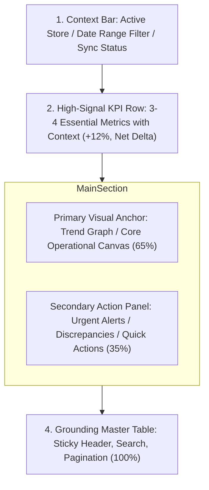
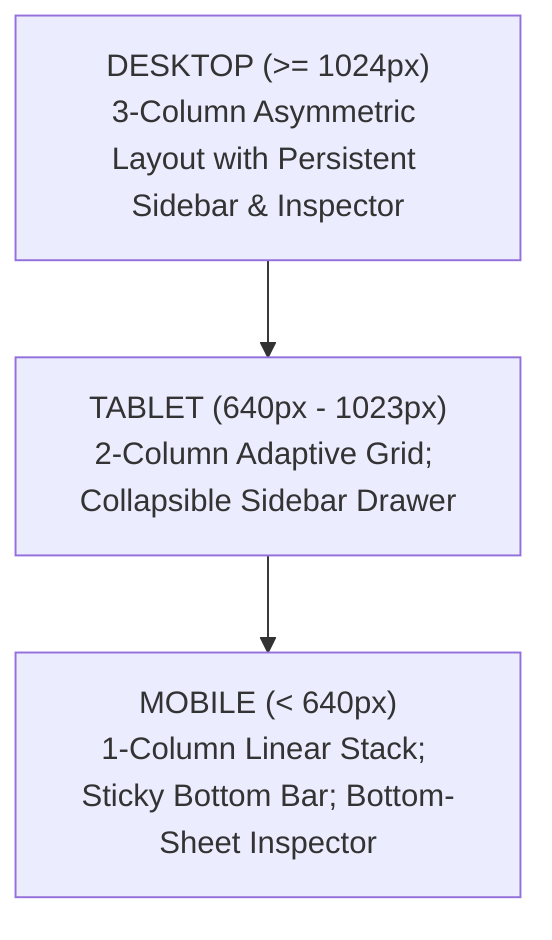

# Advanced Interface Composition & Layout Intelligence — layout-patterns.md

> **Role & Authority**: World-Class Layout Designer, Principal Product Designer, and Visual Art Director (15+ years of digital product leadership across tier-one technology companies).  
> **Purpose**: The master compositional guide establishing how interfaces are architected, structured, balanced, and rhythmically paced. Eliminates repetitive, generic template clichés in favor of context-tailored, expressive, and ergonomic layout systems.

---

## Table of Contents
1. [Layout Thinking Before Implementation](#1-layout-thinking-before-implementation)
2. [Visual Composition Principles](#2-visual-composition-principles)
3. [The Layout Pattern Library](#3-the-layout-pattern-library)
4. [Page-Specific Layout Intelligence](#4-page-specific-layout-intelligence)
5. [Dashboard Composition Intelligence](#5-dashboard-composition-intelligence)
6. [Visual Hierarchy & Content Prioritization](#6-visual-hierarchy--content-prioritization)
7. [Whitespace & Information Density Management](#7-whitespace--information-density-management)
8. [Above-the-Fold Architecture](#8-above-the-fold-architecture)
9. [Layout Variety & Anti-Template Rules](#9-layout-variety--anti-template-rules)
10. [Image and Media Composition](#10-image-and-media-composition)
11. [Responsive Layout Transformations](#11-responsive-layout-transformations)
12. [Layout Accessibility & DOM Order](#12-layout-accessibility--dom-order)
13. [Composition Exploration Protocol](#13-composition-exploration-protocol)
14. [Layout Quality Review & Critique Checklist](#14-layout-quality-review--critique-checklist)
15. [Integration With Other Design Files](#15-integration-with-other-design-files)

---

## 1. Layout Thinking Before Implementation

Layout is not the mechanical act of arranging boxes in CSS Grid or Flexbox. **Layout is the spatial orchestration of human attention.**

A master designer never selects a layout because it is familiar or quick to build. Before choosing a layout model, interrogate the content through eight structural lenses:

1. **Page Purpose**: Is this an operational cockpit demanding rapid glanceability, an editorial narrative meant for contemplative reading, or an action-oriented transaction flow?
2. **Information Nature**: Is the content homogeneous (a table of 500 identical inventory SKUs) or heterogeneous (metrics, activity streams, interactive maps, and reward cards)?
3. **Content Relationships**: Which elements are peers, which are parent-child, and which provide auxiliary context (e.g., inspector panels)?
4. **Primary User Objective**: What is the single most critical task on this canvas, and how does the layout guide the eye directly toward it?
5. **Section Hierarchy & Weight**: What represents the core 20% signal that warrants 80% of the visual prominence?
6. **Required Information Density**: Does the user need maximum data throughput without scrolling, or generous breathing room to reduce decision stress?
7. **Viewport Real Estate**: How does the spatial balance shift between an ultrawide desktop monitor ($1920\text{px}+$) and a compact mobile screen ($375\text{px}$)?
8. **Visual Personality**: Is the interface clinical and razor-sharp (Linear, Stripe) or warm, gamified, and tactile (Tomo Adventures)?

---

## 2. Visual Composition Principles

Every high-caliber layout relies on classical graphic design principles adapted for interactive digital canvases.

```
+-------------------------------------------------------------------------+
| ASYMMETRICAL DYNAMIC BALANCE                                            |
|                                                                         |
| [ DOMINANT HERO / METRIC CARD: 60% ]       [ ACTIVITY STREAM: 40% ]     |
| - High contrast focal point                - Supporting metadata        |
| - Large typographic scale                  - Micro-items with avatars   |
| - Primary call to action                   - Continuous subtle updates  |
|                                                                         |
| [ FULL-WIDTH TABLE / OPERATIONAL CANVAS: 100% ]                         |
| - Grounded horizontal baseline                                          |
+-------------------------------------------------------------------------+
```

### 2.1. Structural Composition Rules
- **Visual Hierarchy**: The relative visual importance of elements must match their real-world operational importance. Establish hierarchy through scale, contrast, positioning, and white space.
- **Symmetry vs. Asymmetry**:
  - *Symmetrical Layouts*: Evoke stability, formality, and calmness. Best for login screens, celebratory reward milestones, and profile summaries.
  - *Asymmetrical Layouts*: Create dynamic tension, directional flow, and modern energy. A wide 65% primary analytical view paired with a 35% contextual action panel guides the eye naturally from analysis to action.
- **Negative Space (Active Whitespace)**: Whitespace is not empty void; it is a structural buffer that prevents cognitive overload and isolates focal points.
- **Visual Rhythm & Cadence**: Alternate between dense data clusters and spacious summary zones to give the user's eye natural rest stops.
- **Focal Points & Directional Flow**: Guide the eye using natural scanning patterns:
  - *F-Pattern*: For text-heavy documentation, tables, and search results.
  - *Z-Pattern*: For landing page heroes and spacious confirmation screens.
  - *Layer-Cake Pattern*: For dashboards with alternating KPI rows and data sections.

---

## 3. The Layout Pattern Library

Select structural layout patterns based on explicit content dynamics. Never force content into an incompatible pattern.

### 3.1. Split Layouts
Split layouts establish immediate side-by-side relationships between complementary content blocks.

```
A1: Text & Visual Split              A2: Sidebar & Work Canvas (POS / App)
+----------------+----------------+  +--------+---------------------------+
| Headline & CTA | Rich Media /   |  | Nav /  | Primary Operational       |
| Key Value Prop | Interactive 3D |  | Drawer | Canvas / Data Grid        |
| (40% - 50%)    | (50% - 60%)    |  | (240px)| (Flex-1 / Calc(100%-240px)|
+----------------+----------------+  +--------+---------------------------+

A3: Master-Detail / Inspector        A4: Asymmetric 60/40 Split
+-----------------+---------------+  +---------------------+--------------+
| Filterable List | Selected Item |  | Primary Performance | Real-Time    |
| / Audit Records | Detail Panel  |  | Graph & KPI Summary | Audit Log    |
| (60% - 65%)     | (35% - 40%)   |  | (60% - 65%)         | (35% - 40%)  |
+-----------------+---------------+  +---------------------+--------------+
```

- **Text & Visual Split**: Ideal for onboarding screens, value propositions, and authentication portals.
- **Sidebar & Canvas**: The standard for complex applications, allowing persistent domain traversal without destroying canvas context.
- **Master-Detail (Two-Column)**: Prevents context loss in record review workflows (e.g., Cycle Count audits: list of discrepancies on the left, RFID tag details and SKU image on the right).

---

### 3.2. Grid Layouts
Grids impose mathematical order while enabling diverse component scales.

```
B1: Bento Grid (Heterogeneous)       B2: Dense Metric Grid
+-----------------------+---------+  +--------+--------+--------+--------+
| Dominant Feature Card | Stat A  |  | KPI 1  | KPI 2  | KPI 3  | KPI 4  |
| (Col-Span-2, Row-2)   +---------+  +--------+--------+--------+--------+
|                       | Stat B  |  | Compact metrics with sparklines   |
+-----------------------+---------+  +-----------------------------------+
| Secondary Feature C   | Stat D  |  B3: Modular Data Grid
| (Col-Span-2)          | (Col-1) |  | Balanced multi-card comparison    |
+-----------------------+---------+  +-----------------------------------+
```

- **Bento Grids**: Tailored for heterogeneous data (e.g., combining a map view, a live coin count, a progress ring, and an achievement badge). One dominant anchor card paired with smaller satellite cards.
- **Dense Operational Grids**: For trading, POS, or inventory counters where 4–6 compact KPI metrics sit in a tight horizontal sequence.
- **Masonry Layouts**: Reserved strictly for content with variable natural heights (e.g., photo galleries, customer reviews). Never use masonry for structured operational data where misaligned baselines break scanning.

---

### 3.3. Editorial Layouts
Editorial compositions draw inspiration from high-end publications (Swiss typography, broadsheet magazines).

```
+-------------------------------------------------------------------------+
| DISPLAY HEADLINE IN PLAYFAIR / GOWUN BATANG (48px)                     |
| Concise editorial sub-narrative spanning max 60 characters...          |
|                                                                         |
| +-----------------------------------+  +------------------------------+ |
| | Oversized Lead Feature Story      |  | Asymmetric Column            | |
| | - High-resolution photography     |  | - Supporting interview notes | |
| | - Rich drop-cap typography        |  | - Pull quote with 2px accent | |
| +-----------------------------------+  +------------------------------+ |
+-------------------------------------------------------------------------+
```

- **When to Use**: Brand storytelling, release notes, creator portfolios, onboarding manifestos, and luxury product showcases.
- **Key Characteristics**: Expressive typographic contrast, deliberate asymmetric placement, large pull quotes, generous negative space.

---

### 3.4. Layered Layouts & Depth Architecture
Layered layouts use spatial elevation ($z$-axis) to establish clear hierarchy between the canvas and interactive controls.

```
+-------------------------------------------------------------------------+
| BACKGROUND CANVAS (Map / Operational Floorplan / Dark Substrate)        |
|                                                                         |
|      +------------------------------------------------------------+     |
|      | FLOATING GLASS / ELEVATED HUD (z-10, backdrop-blur-md)     |     |
|      | [ Active Adventure: Shibuya Hunt ]  [ Coins: +450 ] [ Profile ]  |
|      +------------------------------------------------------------+     |
|                                                                         |
|   +--------------------------+                                          |
|   | FLOATING CONTROLS (z-20) |                                          |
|   | [ Recenter ] [ Filter ]  |                                          |
|   +--------------------------+                                          |
+-------------------------------------------------------------------------+
```

- **When to Use**: Interactive maps (Tomo Adventures), spatial canvases (Figma), video workbenches, and bottom-sheet mobile drawers.
- **Key Rules**: Backgrounds must remain legible; floating HUDs must use frosted translucent materials (`backdrop-blur-md bg-surface/90`) paired with 1px hairline borders to prevent visual vibration.

---

### 3.5. Timeline and Sequential Layouts
Sequential layouts visualize progression, audit histories, and time-based status changes.

```
VERTICAL TIMELINE                     STEP-BASED WORKFLOW WIZARD
+----------------------------------+  +-----+      +-----+      +-----+
| (o) 14:30 - Tag Verified         |  | (1) | ===> | (2) | ===> | (3) |
|  |  HU-9021 scanned by Operator  |  | Sku |      | Qty |      | Done|
| (o) 14:15 - Discrepancy Flagged  |  +-----+      +-----+      +-----+
|  |  Shortage: -3 units detected  |  Horizontal stepper with clear 
| ( ) 13:00 - Audit Initialized    |  completed, active, and pending states
+----------------------------------+
```

- **Vertical Timelines**: Best for audit logs, activity feeds, order tracking, and revision histories.
- **Horizontal Steppers**: Best for linear workflows (e.g., checkout, store onboarding) where users move step-by-step through a bounded sequence.

---

## 4. Page-Specific Layout Intelligence

Different product archetypes require fundamentally distinct layout mental models:

| Product Category | Primary Layout Priority | Recommended Layout Architecture | Anti-Pattern to Avoid |
| :--- | :--- | :--- | :--- |
| **Enterprise Dashboards** | Operational visibility, rapid triage, high density | Top KPI ribbon $\rightarrow$ Asymmetric split (65% primary chart/table + 35% alert feed) $\rightarrow$ Full-width master data grid. | 12 identical square cards scattered randomly across the screen. |
| **Gamified / Rewards (Tomo)** | Emotional delight, touch ergonomics, focus | Centered mobile-viewport shell $\rightarrow$ Prominent hero reward showcase $\rightarrow$ Horizontal carousel cards $\rightarrow$ Persistent bottom thumb bar. | Clinical database tables with no personality or spatial breathing room. |
| **SaaS Applications** | Feature discoverability, navigation clarity | Persistent sidebar rail $\rightarrow$ Header with breadcrumbs & actions $\rightarrow$ Modular card workspace. | Burying navigation behind unlabelled hamburger menus on desktop. |
| **Developer Tools** | Velocity, keyboard efficiency, precision | Split pane with resizable columns $\rightarrow$ Sticky terminal/inspector $\rightarrow$ Dense monospace tables. | Giant bubbly cards and slow animated transitions that delay workflow. |
| **E-Commerce** | Product scannability, price transparency, trust | Sticky filter sidebar $\rightarrow$ Responsive 3-to-4 column product grid $\rightarrow$ Persistent sticky purchase bar on mobile. | Hiding prices or specifications behind unnecessary modal popups. |
| **Landing Pages** | Value narrative, social proof, conversion | Hero Z-pattern $\rightarrow$ Bento feature showcase $\rightarrow$ Alternating split storytelling $\rightarrow$ Social proof wall $\rightarrow$ High-contrast CTA banner. | Stacking 5 identical 3-column feature blocks with zero visual variety. |

---

## 5. Dashboard Composition Intelligence

Data dashboards are operational instruments. Their composition must communicate system health at a glance without visual noise.



### 5.1. Dashboard Composition Rules
1. **Never Make All Metrics Equal**: If total inventory, net variance, and battery level are all in identical $200\times 200\text{px}$ cards, the user cannot discern what is critical. The primary metric must have 2–3x the visual weight of secondary metadata.
2. **Anchor the Canvas**: Provide a strong visual anchor—typically a prominent trend chart or live inventory canvas—that anchors the upper half of the dashboard.
3. **Ground with Data**: Position dense, actionable data tables at the bottom of the page, equipped with sticky headers, pagination, and sorting controls.
4. **Preserve Space in Operational Views**: Do not add 64px padding between operational rows. Use disciplined 8px–16px gutters to maintain high data density.

---

## 6. Visual Hierarchy & Content Prioritization

A user should understand the information structure of any screen in under three seconds without reading individual paragraphs.

```
LEVEL 1: Page Anchor (Display Title / Active Store / Status Pill)
   │  Scale: 24px - 32px | Weight: Bold | High contrast
   │
   ├── LEVEL 2: Section Headings & Primary Metric Values
   │      Scale: 18px - 20px | Weight: Semibold | Medium contrast
   │
   ├── LEVEL 3: Supporting Table Headers & Body Text
   │      Scale: 13px - 14px | Weight: Regular | Balanced contrast
   │
   └── LEVEL 4: Captions, Metadata & Timestamps
          Scale: 11px - 12px | Weight: Medium | Muted contrast
```

### 6.1. The 8 Levers of Hierarchy
1. **Scale**: Larger elements command immediate attention.
2. **Position**: Elements placed top-left (or top-center) are perceived first.
3. **Contrast**: High luminance differences draw the eye instantly.
4. **Weight**: Bold weights establish anchor points within body copy.
5. **Whitespace**: Generous spatial buffers elevate an element to VIP status.
6. **Color**: Intentional brand accents or semantic red/green indicators cut through monochromatic neutrals.
7. **Elevation**: Floating cards with diffuse shadows step forward from flat backgrounds.
8. **Alignment**: Breaking an established alignment grid draws immediate focus to a specific element.

---

## 7. Whitespace & Information Density Management

Whitespace is not empty space; it is a precision design tool.

```
HIGH-DENSITY OPERATIONAL                   SPACIOUS CONSUMER / EDITORIAL
+---------------------------------------+  +---------------------------------------+
| [SKU-892] Qty: 42  Diff: -3  [Resolve]|  |                                       |
| [SKU-893] Qty: 18  Diff:  0  [Verified]|  |           DAILY REWARD                |
| [SKU-894] Qty: 05  Diff: +1  [Resolve]|  |             +250 COINS                |
| - Compact 8px padding                 |  |                                       |
| - 12px micro-typography               |  | - Generous 32px-48px padding          |
| - Maximum visible records per screen  |  | - Centered celebratory composition    |
+---------------------------------------+  +---------------------------------------+
```

### 7.1. Calibrating Density
- **Dense Operational (POS, Inventory, Terminals)**: 4px–8px spacing units, 12px–13px typography, minimal card chrome, high data throughput.
- **Balanced Productivity (SaaS, Admin Panels, Project Management)**: 12px–16px spacing units, 14px body typography, 16px–24px card padding.
- **Spacious Consumer / Storytelling (Tomo, Landing Pages, Portfolios)**: 24px–48px spacing units, 16px–20px body typography, luxurious breathing room.

---

## 8. Above-the-Fold Architecture

The initial visible viewport ($100\text{vh}$ or first 800px) determines whether a user stays, understands, and takes action.

### 8.1. Above-the-Fold Strategy
- **Immediate Value Statement**: In under 50ms, clarify what the product or screen does.
- **Actionable Focal Point**: The primary CTA (e.g., `Start Count`, `Claim Coins`, `Export Report`) must be visible above the fold without requiring a scroll.
- **The Tease / Horizon Line**: Never create a false bottom where a full-width flat line makes users assume the page ends. Peek the top of the next section or provide an ambient downward indicator to encourage natural scrolling.

---

## 9. Layout Variety & Anti-Template Rules

### 9.1. The "Generic AI Dashboard" Cliché
Antigravity must **never** default to this lazy, repetitive layout template:

```
❌ THE REPETITIVE AI TEMPLATE (STRICTLY FORBIDDEN AS DEFAULT)
+-------------------------------------------------------------------------+
| Title + Generic Subtitle                                                |
+-------------------+-----------------+-----------------+-----------------+
| Card 1 (Stat)     | Card 2 (Stat)   | Card 3 (Stat)   | Card 4 (Stat)   |
+-------------------+-----------------+-----------------+-----------------+
| Card 5 (Chart)    | Card 6 (Chart)  | Card 7 (Chart)  | Card 8 (Chart)  |
+-------------------+-----------------+-----------------+-----------------+
| Generic Table with 5 Columns                                            |
+-------------------------------------------------------------------------+
```

### 9.2. How to Architect Varied, Sophisticated Layouts
- **Break Card Uniformity**: Merge two cards into a dominant feature banner; use a split asymmetric composition; let a table or chart span the full height of a side panel.
- **Use Horizontal Spans**: Contrast a vertical activity list with a horizontal metric ribbon.
- **Vary Visual Densities**: Place a compact, high-density toolbar above a spacious, uncluttered preview canvas.

---

## 10. Image and Media Composition

Imagery must be structurally integrated into the composition, never dropped in as arbitrary clipart.

### 10.1. Image Rules
- **Calibrated Aspect Ratios**: Standardize on disciplined ratios: $16:9$ for widescreen feature banners, $4:3$ for product cards, $1:1$ for avatars and coin tokens.
- **Aspect Ratio Containment**: Always pair images with `object-cover` and container dimensions to prevent layout shifts.
- **Text-Over-Image Contrast**: When text overlays an image (e.g., Tomo map cards), always apply a dark gradient scrim (`bg-gradient-to-t from-black/80 via-black/40 to-transparent`) behind the text to guarantee WCAG 4.5:1 legibility.

---

## 11. Responsive Layout Transformations

Responsive design is not simply shrinking desktop containers. It is the conscious structural rearrangement of content across form factors.



### 11.1. Transformation Strategies
- **Multi-Column $\rightarrow$ Single-Column Stack**: Side-by-side columns stack vertically in logical order of importance (primary content first, auxiliary metadata second).
- **Horizontal Navigation $\rightarrow$ Bottom Thumb Bar / Drawer**: On mobile viewports ($<640\text{px}$), move primary navigation to the bottom thumb zone.
- **Floating Modals $\rightarrow$ Bottom Sheets**: Center modals transform into thumb-friendly bottom sheets anchored to the screen base.

---

## 12. Layout Accessibility & DOM Order

Visual layout must never conflict with underlying document semantics.

### 12.1. Accessibility Invariants
- **DOM Order Matches Visual Order**: Flexbox `order` or CSS Grid positioning must never cause tab order to jump erratically across the screen. Screen readers and keyboard navigators must read content in the identical logical sequence presented visually.
- **Meaningful Heading Nesting**: Always structure headings hierarchically: `h1` (Page Title) $\rightarrow$ `h2` (Major Sections) $\rightarrow$ `h3` (Card Titles / Subsections). Never skip from `h1` to `h4` purely for CSS sizing (use Tailwind utility classes for visual scale).
- **No Reliance on Spatial Location Alone**: Never write instructions like "Click the button on the top right." Refer to controls by their explicit accessible names: "Click the **Export Report** button."

---

## 13. Composition Exploration Protocol

For important pages, evaluate at least two distinct composition models before settling on the optimal architecture:

```
EXPLORATION MATRIX FOR A CYCLE COUNT / REWARD SCREEN:

Direction A: The Operational Split (Focused & Fast)
- Left 60%: Searchable audit discrepancy table.
- Right 40%: Sticky inspector with SKU details, image, and quick-resolve buttons.
- Strengths: Zero context switching, extreme throughput.

Direction B: The Bento Overview (Glanceable & Executive)
- Top 40%: Hero discrepancy breakdown + variance trend chart.
- Bottom 60%: Filterable data table with expanding drawer rows.
- Strengths: Superior high-level executive glanceability.
```

Compare candidate directions based on:
1. **User Velocity**: Which path lets the user complete their goal with fewer clicks?
2. **Cognitive Calm**: Which composition feels less cluttered under heavy data loads?
3. **Responsive Resilience**: Which layout transitions seamlessly to mobile without breaking?

---

## 14. Layout Quality Review & Critique Checklist

Before finalizing any interface layout, conduct this 10-point Director's Audit:

- [ ] **Category Fit**: Does the layout match the product archetype (operational, gamified, editorial)?
- [ ] **Unmistakable Focal Point**: Is the eye guided to the singular primary element within 50ms?
- [ ] **Clear Hierarchy**: Does typographic scale and spatial weight communicate importance instantly?
- [ ] **Dynamic Balance**: Is the canvas visually weighted without awkward gaps or crowded corners?
- [ ] **Cadence & Rhythm**: Does the page alternate gracefully between dense data and resting white space?
- [ ] **Anti-Template Check**: Has the generic "4-card + chart + table" cliché been consciously avoided?
- [ ] **Above-the-Fold Clarity**: Does the initial viewport communicate purpose and primary action?
- [ ] **Responsive Transformation**: Has the layout been verified across mobile ($375\text{px}$), tablet ($768\text{px}$), and desktop ($1280\text{px}$)?
- [ ] **DOM & Keyboard Coherence**: Does keyboard tab sequence follow the visual reading order?
- [ ] **Purposeful Justification**: Does every column, card, and divider justify its existence?

---

## 15. Integration With Other Design Files

This layout intelligence framework is a core pillar of the design system:
- **`AGENTS.md`**: Master operating directives and technical execution environment.
- **`design-philosophy.md`**: Foundational design thinking, cognitive laws, and aesthetic judgment.
- **`ui-design-system.md`**: Design tokens, color palettes, typography scales, spacing, and radii.
- **`ux-principles.md`**: Human behavior, interaction states, task flows, and accessibility.
- **`layout-patterns.md` (This file)**: Page architecture, composition models, visual hierarchy, and structural diversity.

> **Final Operating Principle**: Every layout should feel deliberately composed for its unique purpose, not assembled from a predictable template.
