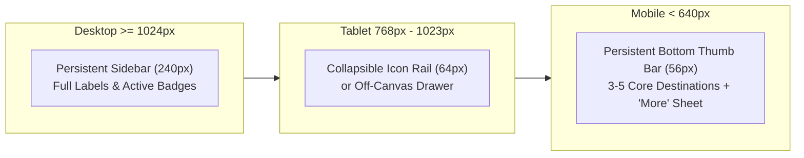

# Advanced Responsive & Adaptive Design Framework — responsive-design.md

> **Role & Authority**: Principal Responsive Design Engineer, Senior UI/UX Designer, and Cross-Platform Frontend Architect (15+ years of digital product leadership across tier-one technology companies).  
> **Purpose**: The definitive technical and structural framework for designing, implementing, stress-testing, and optimizing responsive and adaptive interfaces across mobile, tablet, laptop, desktop, and ultrawide viewports.

---

## Table of Contents
1. [Responsive Design Philosophy](#1-responsive-design-philosophy)
2. [Mobile-First & Context-Aware Strategy](#2-mobile-first--context-aware-strategy)
3. [Responsive Breakpoint Strategy](#3-responsive-breakpoint-strategy)
4. [Mobile Experience Ergonomics](#4-mobile-experience-ergonomics)
5. [Tablet Experience & Two-Column Adaptations](#5-tablet-experience--two-column-adaptations)
6. [Desktop Experience & Spatial Density](#6-desktop-experience--spatial-density)
7. [Ultrawide & Large Display Architecture](#7-ultrawide--large-display-architecture)
8. [Adaptive Navigation Architecture](#8-adaptive-navigation-architecture)
9. [Fluid & Responsive Typography](#9-fluid--responsive-typography)
10. [Adaptive Spacing & Layout Rhythm](#10-adaptive-spacing--layout-rhythm)
11. [Responsive Tables & Enterprise Data Grids](#11-responsive-tables--enterprise-data-grids)
12. [Responsive Forms & Input Handling](#12-responsive-forms--input-handling)
13. [Responsive Imagery & Media Handling](#13-responsive-imagery--media-handling)
14. [Touch, Pointer & Keyboard Modalities](#14-touch-pointer--keyboard-modalities)
15. [Responsive Modals, Drawers & Overlays](#15-responsive-modals-drawers--overlays)
16. [Responsive Performance & Zero-Jank Engineering](#16-responsive-performance--zero-jank-engineering)
17. [Multi-Viewport Testing & Quality Matrix](#17-multi-viewport-testing--quality-matrix)
18. [Responsive Anti-Patterns to Reject](#18-responsive-anti-patterns-to-reject)
19. [Responsive Quality Gate & Critique Checklist](#19-responsive-quality-gate--critique-checklist)
20. [Integration With Other Design Files](#20-integration-with-other-design-files)

---

## 1. Responsive Design Philosophy

Responsive design is **not** a collection of media queries applied after a desktop layout is finished. It is the conscious spatial orchestration of information hierarchy across varying physical environments.

### 1.1. Core Directives
- **Universal Requirement**: Responsiveness is a fundamental architectural requirement. An interface that breaks or overflows on any device is a broken product.
- **Content-Driven Adaptation**: Layouts adapt based on the natural bounding requirements of the content and the user's task, not arbitrary vendor device names (iPhone 14, Pixel 7).
- **Functionality Parity**: Never silently strip critical features, columns, or actions on mobile. Adapt the presentation, transform tables into card drawers, or provide progressive disclosure—but preserve complete user capability.
- **Visual Hierarchy & Ergonomics**: Preserve readability, thumb zones, and focal anchors across every transition.
- **Zero Accidental Overflow**: The horizontal scrollbar on the root document (`html`, `body`) is the hallmark of careless engineering. Guard against horizontal body overflow ruthlessly.
- **Empirical Verification**: Never assume media queries work because the math looks right in CSS. Inspect and test the actual rendered output across physical viewport sizes.

---

## 2. Mobile-First & Context-Aware Strategy

While **Mobile-First** (authoring base CSS for mobile viewports and scaling upward via `min-width` breakpoints) is standard for consumer web apps, design architecture must remain context-aware.

```
+-----------------------------------------------------------------------+
| CONTEXT-DRIVEN STRATEGY SELECTION                                     |
|                                                                       |
| Consumer / Gamified (Tomo Rewards):                                   |
|   -> Mobile-First Core Architecture                                   |
|   -> Touch-first thumb zone, bottom navigation, bottom sheets         |
|   -> Expands into centered container shells on desktop                |
|                                                                       |
| Enterprise Operations (POS / RFID Cycle Count Audits):                |
|   -> Desktop / Tablet-First Operational Core                          |
|   -> Multi-column data density, keyboard traversal, split inspectors  |
|   -> Gracefully degrades into stacked summary cards on mobile         |
+-----------------------------------------------------------------------+
```

### 2.1. Context Discovery Dimensions
Before writing CSS or JSX, evaluate:
1. **Input Modality**: Touch taps vs. mouse pointers vs. barcode/RFID scanners vs. keyboard shortcuts.
2. **Physical Environment**: High-glare retail floor, distracted walking consumer, or stationary multi-monitor desk.
3. **Session Duration**: 15-second micro-interactions (claiming coins) vs. 4-hour continuous data entry audits.
4. **Information Density Requirements**: High-density table throughput vs. spacious contemplative reading.

---

## 3. Responsive Breakpoint Strategy

Breakpoints mark the thresholds where layout structure must adapt to preserve usability.

### 3.1. Reference Breakpoint Spectrum (Tailwind CSS v4 Compatible)

| Breakpoint Tier | Pixel Range | Primary Physical Devices | Architectural Layout Strategy |
| :--- | :--- | :--- | :--- |
| **Small Mobile** | `320px – 374px` | Compact smartphones (iPhone SE) | Strict 1-column stack; compact typography; full-width touch targets. |
| **Standard Mobile (`sm`)**| `375px – 479px` | Modern flagship smartphones | 1-column layout; bottom navigation rail; bottom sheets for dialogs. |
| **Large Mobile / Phablet**| `480px – 767px` | Plus/Max phones, small foldables | 1-to-2 column adaptive flex; compact filters; landscape optimization. |
| **Tablet (`md`)** | `768px – 1023px` | iPad, iPad Mini, Surface tablets | 2-column grids; collapsible navigation drawer; master-detail splits. |
| **Laptop / Small Desktop (`lg`)**| `1024px – 1279px`| Standard laptops, 13" MacBooks | Persistent sidebar navigation; multi-column operational tables. |
| **Standard Desktop (`xl`)** | `1280px – 1535px`| External monitors, 15"/16" laptops| 3-column layouts; persistent contextual inspector panels. |
| **Ultrawide (`2xl`)** | `1536px+` | 27"+ monitors, 4K displays | Bounded max-width (`max-w-7xl`); centered auto-margins; preserved line lengths. |

> **Invariant**: Prefer the project's standard Tailwind breakpoints (`sm: 640px`, `md: 768px`, `lg: 1024px`, `xl: 1280px`, `2xl: 1536px`). Do not introduce random ad-hoc pixel breakpoints (`@media (min-width: 917px)`) unless an isolated component geometry explicitly breaks.

---

## 4. Mobile Experience Ergonomics

Designing for mobile devices ($<640\text{px}$) requires radical prioritization and anatomical awareness of the human hand.

```
THE MOBILE THUMB ZONE (< 640px)
+-----------------------------+
| TOP ZONE: HARD REACH        |
| - Back navigation arrow     |
| - Passive page title        |
|                             |
| REACH ZONE: MEDIUM EFFORT   |
| - Filter summary chips      |
| - Search input              |
|                             |
| NATURAL THUMB ZONE (EASY)   |
| - Primary Action Button     |
| - Bottom Navigation Bar     |
| - Bottom Sheet Controls     |
+-----------------------------+
```

### 4.1. Mobile Directives
- **Single-Column Trajectory**: Content flows vertically in a single linear stack (`flex-col space-y-4`). Avoid side-by-side buttons or multi-column text that forces horizontal squinting.
- **Persistent Bottom Action Bar**: Pin primary transaction buttons to the bottom of the viewport (`fixed bottom-0 left-0 right-0 p-4 bg-surface/95 backdrop-blur border-t border-border-subtle`).
- **Touch Target Dimensions**: Every tappable button, tab, link, and control must have a physical hit area $\ge 44 \times 44\text{px}$.
- **Safe Area Insets**: Always respect device notches and home indicator bars:
  ```css
  padding-bottom: env(safe-area-inset-bottom, 16px);
  padding-top: env(safe-area-inset-top, 0px);
  ```
- **Virtual Keyboard Defensiveness**: Forms must not allow the on-screen keyboard to obscure the active input or the primary submit button. Use `scrollIntoView({ behavior: 'smooth', block: 'center' })`.

---

## 5. Tablet Experience & Two-Column Adaptations

Tablets ($768\text{px}$–$1023\text{px}$) are frequently neglected by simply stretching mobile views or shrinking desktop views. They represent a unique hybrid form factor.

### 5.1. Tablet Ergonomics
- **2-Column Adaptive Grids**: Transition single-column mobile stacks into balanced 2-column or 3-column grids (`grid-cols-1 md:grid-cols-2 lg:grid-cols-3`).
- **Collapsible Navigation Rail**: Replace the full $240\text{px}$ desktop sidebar with a $64\text{px}$ icon-only rail or an off-canvas drawer that expands upon tapping a hamburger trigger.
- **Orientation Resilience**: Verify layout stability when transitioning between Portrait ($768\times 1024$) and Landscape ($1024\times 768$).
- **Dual Input Support**: Accommodate both direct fingertip touch and precision stylus / trackpad pointers.

---

## 6. Desktop Experience & Spatial Density

Desktop displays ($1024\text{px}$–$1535\text{px}$) provide the canvas for deep focus, operational speed, and high information throughput.

### 6.1. Desktop Optimizations
- **Persistent Contextual Navigation**: Render a dedicated $240\text{px}$ sidebar rail, displaying full labels, notification counters, and organizational switches.
- **Asymmetrical 3-Column Workspaces**: Left sidebar ($240\text{px}$) $\rightarrow$ Center operational canvas ($\text{flex-1}$) $\rightarrow$ Right contextual inspector ($360\text{px}$–$400\text{px}$).
- **High Data Density**: Tables display full attribute sets, sticky headers, multi-column sorting, and inline row action triggers.
- **Pointer Ergonomics**: Enable crisp hover micro-interactions ($100\text{ms}$ transitions), contextual right-click menus, and keyboard shortcuts (`⌘K`, `Escape`, `Tab`).

---

## 7. Ultrawide & Large Display Architecture

On wide screens ($>1536\text{px}$ and $4\text{K}$ monitors), unconstrained layouts stretch into unreadable, exhausting horizontal monstrosities.

```
❌ UNCONSTRAINED FULL-WIDTH BLUNDER (> 1920px)
+-------------------------------------------------------------------------------------------------------+
| Title                                                                                   Action Button |
| This text line stretches across 2500 pixels, creating 350 characters per line. The human eye cannot   |
| trace back to the beginning of the next line without getting completely lost and exhausted.           |
+-------------------------------------------------------------------------------------------------------+

✔ BOUNDED CONTAINER ARCHITECTURE (max-w-7xl mx-auto)
               +-------------------------------------------------------------+
               | Title                                         Action Button |
               | Content line lengths are bounded to 650px.                  |
               | Multi-column grids expand gracefully with balanced gutters. |
               +-------------------------------------------------------------+
```

### 7.1. Ultrawide Invariants
- **Maximum Content Width**: Always bind root application canvases within calibrated bounds (`max-w-7xl mx-auto px-6` or `max-w-6xl`).
- **Strict Measure (Line Length)**: Body typography must never exceed 75 characters ($\sim 650\text{px}$).
- **Never Enlarge UI Arbitrarily**: Wider viewports do not mean buttons should become gigantic $300\text{px}$ slabs. Keep component controls proportioned; let the surrounding canvas provide luxurious, structured negative space.

---

## 8. Adaptive Navigation Architecture

Navigation must gracefully transform across viewport boundaries without burying essential user capabilities.



### 8.1. Navigation Transformation Rules
1. **Desktop $\rightarrow$ Mobile Bar**: Move the top 3–5 primary destinations (e.g., Tomo: *Adventures, Map, Profile*) to a sticky bottom navigation bar.
2. **Auxiliary Settings & Legal**: Move secondary links (Terms, Privacy, Help, Logout) into a dedicated profile sub-sheet accessible via the `Profile` tab.
3. **Breadcrumbs Adaptation**: On mobile, truncate deep breadcrumbs (`Stores / Shibuya / Audits / #8921`) to a single prominent back button: `← Audits`.

---

## 9. Fluid & Responsive Typography

Typography must scale proportionally across screens to maintain hierarchy and prevent text collision.

### 9.1. Mathematical Fluid Scaling with `clamp()`
Use CSS `clamp(min, preferred, max)` to smoothly interpolate type sizes without abrupt breakpoint jumps:

```css
/* Fluid Display Headings */
h1.display-title {
  font-size: clamp(1.75rem, 1.2rem + 2.5vw, 2.75rem); /* 28px -> 44px */
  line-height: 1.15;
}

/* Fluid Page Headings */
h2.page-title {
  font-size: clamp(1.35rem, 1.1rem + 1.25vw, 1.875rem); /* 21.6px -> 30px */
  line-height: 1.25;
}

/* Standard Body Copy (Bounded) */
p.body-text {
  font-size: 0.875rem; /* 14px on mobile */
  line-height: 1.5;
}
@media (min-width: 1024px) {
  p.body-text {
    font-size: 1rem; /* 16px on desktop */
  }
}
```

### 9.2. Typography Guardrails
- **Minimum Body Size on Mobile**: Never allow mobile body copy to drop below $13\text{px}$ / $0.8125\text{rem}$. Text below $12\text{px}$ causes severe squinting and fails accessibility audits.
- **Word Wrapping & Truncation**: Always protect layout containers against long unbreakable words (e.g., RFID hashes, email addresses) using `break-words` or `truncate`.

---

## 10. Adaptive Spacing & Layout Rhythm

Spacing must breathe on large monitors while tightening on compact mobile viewports.

### 10.1. Responsive Spacing Scale
- **Outer Page Gutters**: `px-4 sm:px-6 lg:px-8` (16px on mobile $\rightarrow$ 24px on tablet $\rightarrow$ 32px on desktop).
- **Section Gaps**: `space-y-6 sm:space-y-8 lg:space-y-12` (24px on mobile $\rightarrow$ 32px on tablet $\rightarrow$ 48px on desktop).
- **Card Internal Padding**: `p-4 sm:p-5 lg:p-6` (16px on mobile $\rightarrow$ 20px on tablet $\rightarrow$ 24px on desktop).
- **Grid Gutters**: `gap-3 sm:gap-4 lg:gap-6` (12px on mobile $\rightarrow$ 16px on tablet $\rightarrow$ 24px on desktop).

---

## 11. Responsive Tables & Enterprise Data Grids

Data tables are notoriously challenging on mobile viewports. Never resort to ugly unformatted tables that break out of the screen.

```
RESPONSIVE TABLE STRATEGIES

Strategy 1: Priority Column Visibility (Responsive Triage)
+-------------------------------------------------------------------+
| ARTICLE       | CATEGORY (Hidden <md) | BOOK (Hidden <sm) | DIFF  |
+-------------------------------------------------------------------+
| RFID-9821-XL  | [Apparel]             | [120]             | -3    |
+-------------------------------------------------------------------+

Strategy 2: Stacked Mobile Record Cards (< 640px)
+-------------------------------------------------------------------+
| [ARTICLE: RFID-9821-XL]                         [NET DIFF: -3]    |
| Category: Apparel | Book: 120 | Counted: 117                      |
| [View Discrepancy Details ->]                                     |
+-------------------------------------------------------------------+

Strategy 3: Contained Horizontal Scroll with Gradient Scrim
+-------------------------------------------------------------------+
| [Sticky Col: SKU] | Col 2 | Col 3 | Col 4 | Col 5 | Col 6 >>>>>>  |
+-------------------------------------------------------------------+
```

### 11.1. Implementation Invariants
- **Never Silently Drop Essential Data**: If secondary columns are hidden on mobile via `hidden md:table-cell`, provide a chevron tap trigger that expands an inline drawer or card showing the full record attributes.
- **Contained Overflow**: When horizontal scrolling is necessary, wrap the table inside `<div className="overflow-x-auto -mx-4 px-4 sm:mx-0 sm:px-0">` so horizontal scrolling stays trapped within the table container without shifting the root page.

---

## 12. Responsive Forms & Input Handling

Forms on mobile must minimize physical typing and maximize touch efficiency.

### 12.1. Mobile Form Rules
- **1-Column Single Stack**: Multi-column forms (e.g., First Name next to Last Name) become cramped and awkward on mobile. Collapse all fields into a single vertical stack (`grid-cols-1`).
- **Touch-Friendly Controls**: Dropdowns, datepickers, and radio buttons must provide a minimum $44\text{px}$ touch height.
- **Native Input Triggers**:
  - Currency / Numbers: `inputMode="decimal"`
  - Telephone: `type="tel"`
  - Email: `type="email"`
  - Date: Native `<input type="date">` on iOS/Android to leverage fluid native scroll wheels.

---

## 13. Responsive Imagery & Media Handling

Images must resize fluidly without distortion, layout shifts, or excessive bandwidth consumption.

### 13.1. Media Invariants
- **Cumulative Layout Shift ($\text{CLS}=0$)**: Always declare explicit aspect ratios (`aspect-video`, `aspect-square`, `aspect-[4/3]`) on image containers so the browser reserves layout space before bytes download.
- **Object Fit & Position**: Use `object-cover` paired with `object-center` so imagery crops gracefully across variable card widths without stretching.
- **Responsive Picture Elements**: For heavy hero assets, serve appropriate resolutions via `srcset`:
  ```html
  <picture>
    <source media="(min-width: 1024px)" srcset="/assets/hero-large.webp" />
    <source media="(min-width: 640px)" srcset="/assets/hero-medium.webp" />
    
  </picture>
  ```

---

## 14. Touch, Pointer & Keyboard Modalities

Different devices demand distinct interaction ergonomics:

| Interaction Domain | Touch Viewports (Mobile / Tablet) | Pointer Viewports (Desktop / Laptop) |
| :--- | :--- | :--- |
| **Hover Feedback** | **Disabled** (`@media (hover: none)`). Never hide actions inside hover states. | **Enabled** (`hover:bg-neutral-100` with 100ms smooth transition). |
| **Target Sizing** | Generous minimum $44\times 44\text{px}$ physical touch area. | Compact $32\text{px}$–$38\text{px}$ targets easily reached by cursor. |
| **Active States** | Tactile scale compression on touch start (`active:scale-[0.98]`). | Subtle surface color deepening. |
| **Keyboard Navigation**| Virtual keyboard auto-scroll; `done`/`search` action keys. | Tab traversal; roving tab-index; `⌘K` command palettes. |

---

## 15. Responsive Modals, Drawers & Overlays

Dialogs must adapt their morphology to the physical viewport bounds:

```
DESKTOP (>= 768px): CENTERED MODAL        MOBILE (< 640px): BOTTOM SHEET
+---------------------------------------+  +---------------------------------------+
|                                       |  |                                       |
|        +--------------------+         |  |                                       |
|        | CENTERED DIALOG    |         |  |                                       |
|        | max-w-md           |         |  |                                       |
|        | rounded-2xl        |         |  | +-----------------------------------+ |
|        +--------------------+         |  | | (--) DRAG HANDLE                  | |
|                                       |  | | BOTTOM SHEET                      | |
|                                       |  | | rounded-t-2xl w-full max-h-[85vh] | |
+---------------------------------------+  +---------------------------------------+
```

### 15.1. Overlay Invariants
- **Desktop**: Centered modal dialog (`max-w-md` or `max-w-lg`, `rounded-2xl`, diffuse shadow).
- **Mobile**: Anchored bottom sheet (`fixed bottom-0 inset-x-0 rounded-t-2xl max-h-[85vh] overflow-y-auto`) with swipe-down dismissal and top drag handle.
- **Scroll Locking**: When any overlay is active, lock root body scrolling (`overflow-hidden`) to prevent annoying background scroll leakage.

---

## 16. Responsive Performance & Zero-Jank Engineering

A responsive interface that lags, stutters, or reflows during viewport resizing is broken.

### 16.1. Technical Performance Rules
1. **CSS Over JavaScript**: Implement 100% of standard responsive transformations using pure CSS (Flexbox, Grid, container queries, and media queries). Never use window resize listeners in JavaScript (`window.innerWidth`) for basic layout reflow.
2. **GPU-Accelerated Transitions**: When animating mobile drawers or sheet slides, animate exclusively `transform: translateY()` and `opacity`. Never animate `height`, `top`, or `margin`.
3. **Container Queries**: Where supported, leverage `@container` queries for reusable cards so a card adapts its internal layout based on its immediate parent container width rather than the global viewport width.

---

## 17. Multi-Viewport Testing & Quality Matrix

Verify layout integrity against this representative matrix of real-world viewport dimensions:

```
DEVICE VIEWPORT TESTING CHECKLIST
[ ] 320 x 568   ── iPhone SE (1st gen) / Narrow budget mobile
[ ] 375 x 812   ── iPhone 12/13 Mini / Standard compact mobile
[ ] 390 x 844   ── iPhone 14/15 / Standard mobile baseline
[ ] 430 x 932   ── iPhone 15 Pro Max / Large mobile flagship
[ ] 768 x 1024  ── iPad Mini / iPad Portrait
[ ] 1024 x 768  ── iPad Landscape / Surface tablet
[ ] 1280 x 800  ── Standard 13" laptop display
[ ] 1440 x 900  ── MacBook Pro 15" baseline
[ ] 1920 x 1080 ── Full HD Desktop monitor
[ ] 2560 x 1440 ── Ultrawide / 2K Desktop display
```

### 17.1. Inspection Criteria
At each viewport, rigorously verify:
- [ ] Zero unwanted horizontal body scroll (`document.body.scrollWidth === window.innerWidth`).
- [ ] No truncated or colliding text strings.
- [ ] No overlapping cards or buttons.
- [ ] Touch targets remain easily tappable without mis-clicks.
- [ ] Interactive controls remain fully operable via keyboard and touch.
- [ ] Modals and bottom sheets remain fully within screen bounds.

---

## 18. Responsive Anti-Patterns to Reject

Reject these common responsive engineering flaws:
- ❌ **Fixed-Width Containers**: Never set hard pixel widths like `width: 600px` without `max-w-full`.
- ❌ **Fixed-Height Overflow Traps**: Never set fixed heights like `height: 400px` on containers with dynamic text; use `min-h-[400px]` with vertical overflow safety.
- ❌ **Scaled-Down Desktop**: Never use CSS `transform: scale(0.7)` to force a desktop screen into mobile.
- ❌ **Hover-Dependent Critical Actions**: Never hide an `Edit` or `Delete` button behind a desktop `:hover` state without providing a mobile touch alternative.
- ❌ **Tiny Mobile Touch Links**: Never place 12px text links adjacent to each other on mobile touch screens.
- ❌ **Arbitrary Element Disappearance**: Never delete important features on mobile just to make the screen look clean.
- ❌ **Gigantic Mobile Headings**: Never allow 48px display titles to push the entire page content below the mobile fold.

---

## 19. Responsive Quality Gate & Critique Checklist

Before declaring any responsive implementation complete, conduct this final 10-point audit:

- [ ] **1. Zero Horizontal Scroll**: Is the root page completely free of horizontal scrollbar leakage across all viewports?
- [ ] **2. Mobile Thumb Ergonomics**: Are primary actions situated within comfortable thumb reach on mobile screens?
- [ ] **3. Touch Target Integrity**: Are all clickable buttons, pills, and tabs $\ge 44 \times 44\text{px}$ on touch devices?
- [ ] **4. Tablet Layout Adaptation**: Does the tablet view leverage a balanced 2-column or 3-column composition rather than stretching a 1-column mobile view?
- [ ] **5. Desktop Spatial Efficiency**: Does the desktop view utilize multi-column density without looking sparse or empty?
- [ ] **6. Ultrawide Containment**: Is content bounded within `max-w-7xl` or `max-w-6xl` to prevent unreadable line lengths?
- [ ] **7. Table & Data Grid Grace**: Do complex tables degrade into responsive scroll containers, priority columns, or stacked cards?
- [ ] **8. Form Adaptability**: Do forms flow into single-column layouts on mobile with proper virtual keyboard `inputMode`s?
- [ ] **9. Modal & Sheet Adaptation**: Do desktop centered dialogs transform into fluid bottom sheets on mobile?
- [ ] **10. Live Rendered Verification**: Has the UI been verified in an actual browser environment across mobile, tablet, and desktop dimensions?

---

## 20. Integration With Other Design Files

This responsive framework operates in synchronization with the complete design knowledge base:
- **`AGENTS.md`**: Master operating rules, executive mindset, and runtime technical constraints.
- **`design-philosophy.md`**: Foundational design thinking, cognitive laws, and aesthetic judgment.
- **`ui-design-system.md`**: Tokenized foundations (colors, typography scales, spacing, radii).
- **`ux-principles.md`**: Human behavior, interaction states, task flows, and accessibility.
- **`layout-patterns.md`**: Page architecture, spatial composition, and structural grids.
- **`component-guidelines.md`**: Component-level construction, state matrices, and React standards.
- **`responsive-design.md` (This file)**: The definitive cross-device adaptation and viewport engineering specification.

> **Final Operating Principle**: A great interface must feel purposefully crafted for every single screen, never merely squeezed into different dimensions.
