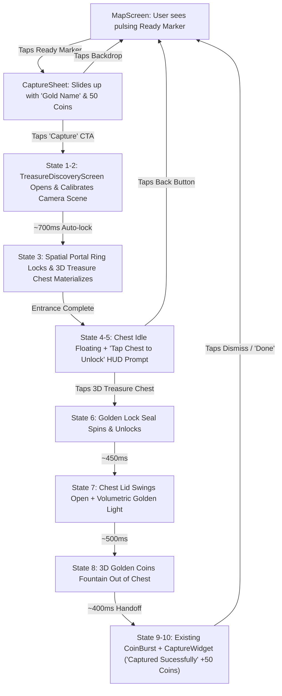
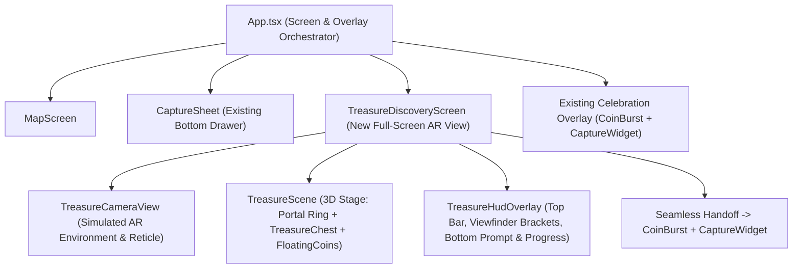

# Tomoboshi AR Treasure Discovery Experience — UI/UX & Technical Implementation Plan

> [!IMPORTANT]
> **Planning-Only Document — Zero Code Modifications**
> This document is a standalone architectural and UI/UX blueprint for the simulated AR Treasure Discovery experience in the Tomoboshi React web application. No source code files (`src/App.tsx`, `src/index.css`), components, or dependencies have been modified. Implementation will only begin after explicit permission.

---

## 1. Existing Application Analysis

### 1.1 Current Codebase & Architecture
- **Entry & Structure**: The application currently resides in [`src/App.tsx`](../src/App.tsx) (~1,787 lines) and [`src/index.css`](../src/index.css) (~4,382 lines), supported by [`src/adventures.json`](../src/adventures.json).
- **Dependencies ([`package.json`](../package.json))**:
  - `react` (`^19.0.0`) & `react-dom` (`^19.0.0`)
  - `tailwindcss` (`^4.0.0`) & `@tailwindcss/vite` (`^4.0.0`)
  - `vite` (`^8.0.5`) & `typescript` (`^5.7.0`)
  - *Note*: Neither `three`, `@react-three/fiber`, `@react-three/drei`, nor `framer-motion` are currently installed.
- **Screen Routing State ([`src/App.tsx`](../src/App.tsx))**:
  - Top-level `screen` state union: `"map" | "adventures" | "leaderboard" | "profile" | "referral"`.
  - Overlay states controlled in `App`:
    - `captureSheetOpen: boolean` — toggles `CaptureSheet` (`z-30`).
    - `captured: boolean` — toggles the celebration overlay (`z-40`) containing `CoinBurst` (`z-20`) and `CaptureWidget`.
    - `rewardVariant: number` (`0..14`) — controls the active visual style among 15 `RewardPill` designs.

### 1.2 Current Map-to-Capture Flow
1. On `MapScreen`, static markers (`capturedMarkers` using `/assets/f0451.png` and `lockedMarkers` using `/assets/8e9eb.png`) are rendered alongside one interactive `.ready-marker` at `left: 23.6%, top: 52.1%`.
2. The `.ready-marker` uses `/assets/08c22.png` (`readyMarker`) and `/assets/4277a.svg` (`readyMarkerBacking`), animated via `@keyframes ready-marker-jump` and `@keyframes ready-marker-ripple`.
3. Tapping `.ready-marker` triggers `onOpenCapture`, which sets `captureSheetOpen = true`.
4. `CaptureSheet` slides up (`@keyframes capture-sheet-in`, `320ms cubic-bezier(0.22, 0.75, 0.25, 1)`), displaying:
   - Drag handle (`/assets/efdf0.svg`)
   - Title: `"Gold Name"` and subtitle: `"0.2 mi • Gold Flag"`
   - `RewardPill` showing `50 coins` (`showPlus={false}`)
   - Primary CTA button: `"Capture"` (black pill `rounded-[40px]`, `#f5c542` bold text, inner/outer shadows)
5. Tapping `"Capture"` currently calls `handleCapture()`, which immediately sets `captureSheetOpen = false` and `captured = true`, skipping any intermediate discovery scene and going straight to `CoinBurst` + `CaptureWidget`.

### 1.3 Established Visual Language & Design Tokens
- **Typography**:
  - Display / Ceremonial headings: `'Gowun_Batang:Bold'` (`20px–28px`, serif elegance, used in `"Captured Sucessfully"` and leaderboard/referral titles).
  - UI / HUD / Controls: `'Inter:Bold'`, `'Inter:Semi_Bold'`, `'Inter:Medium'`, `'Inter:Regular'`.
- **Color Palette**:
  - Primary Brand Gold: `#f5c542`
  - Coin Specular Gradient: `linear-gradient(145deg, #ffe894 15%, #ffc83d 58%, #e8a414 100%)` with border `#e6a817` and inner ring `#b97908`
  - Deep Obsidian / Ink: `#0f1114`, `#17130a`, `#000000`
  - Warm Ivory / Surface: `rgba(255, 255, 255, 0.75)` to `rgba(255, 255, 255, 0.95)` with `backdrop-blur-[5px]` and `border-white/50`
- **Motion Signature**:
  - Springy overshoot curves (`cubic-bezier(0.18, 0.9, 0.3, 1.35)` and `cubic-bezier(0.22, 0.75, 0.25, 1)`)
  - Shimmering foil sweeps (`@keyframes aurora-sheen`, `@keyframes referral-hero-shine`)
  - Full `prefers-reduced-motion: reduce` support in `src/index.css`.

---

## 2. Evaluation of Visual Concepts & Recommendation

| Concept | Visual Appeal | Alignment with Tomoboshi Brand | Mobile Performance & Complexity | Evaluation |
|---|---|---|---|---|
| **A. Golden Treasure Chest** | Very High — tactile, iconic reward anticipation, unmistakable game loop | Strong — echoes the obsidian & gold luxury aesthetic found in Adventure Card V10, Leaderboard Podium, and Referral Hero | Medium — works cleanly as either a stylized 3D object or layered 2.5D/3D scene with lid articulation | **Primary Core Concept**: Best anchor for unlocking, opening, and coin eruption |
| **B. Floating Gold Coins** | High — kinetic, immediate connection to Tomoboshi's signature `CoinIcon` | Native — directly extends the existing `readyMarker` (`/assets/08c22.png`) and `CoinIcon` visual language | Low/Medium — lightweight geometry, directly bridges into the existing `CoinBurst` particle system | **Essential Companion**: Should orbit/erupt from the chest rather than stand alone |
| **C. Treasure Portal** | High — atmospheric golden energy ring / spatial anchor on the ground or mid-air | Moderate-High — works best as the spatial AR grounding reticle/pedestal from which the chest materializes | Low — easily achieved with CSS 3D / WebGL shader rings and golden particles | **Supporting Spatial Anchor**: Ideal as the AR surface lock ring under the chest |
| **D. Treasure Guardian** | Medium-High — adds RPG-style obstacle before unlocking | Low — Tomoboshi's tone is refined lifestyle/wine-trail exploration ("Napa Valley", "Golden Trail"), not combat/fantasy | High — requires rigged character animation, extra interaction steps, and risks slowing down quick mobile captures | **Defer / Exclude from V1**: Overcomplicates the core capture loop and clashes with the refined editorial aesthetic |

### Recommended Focused V1 Concept: **"The Golden Reliquary Chest + Orbital Coin Ring"** (Concept A + B, grounded by a subtle Concept C spatial ring)
- **Why this fits Tomoboshi best**:
  1. Tomoboshi blends real-world lifestyle discovery (vineyards, curated trails) with luxury golden collectibles. A **sleek, obsidian-and-brushed-gold Treasure Chest** resting on a **golden spatial calibration ring** feels like an heirloom vault rather than a cartoon pirate chest.
  2. When tapped, the chest's golden seal unlocks, the lid swings open with a warm volumetric golden glow, and **3D spinning Tomoboshi coins** erupt upward—handing off seamlessly into the existing `CoinBurst` and `CaptureWidget` confirmation.

---

## 3. Complete User Journey & Flowchart

### 3.1 Narrative User Journey
1. **Map Discovery**: The user views `MapScreen` and spots the pulsing golden `.ready-marker` (`"Gold Name • 0.2 mi • Gold Flag"`).
2. **Capture Sheet Preview**: Tapping the marker opens the existing `CaptureSheet` bottom drawer showing the location details and the `50 coins` `RewardPill`.
3. **Entering AR Discovery Mode**: Tapping `"Capture"` inside `CaptureSheet` dismisses the sheet and transitions into the full-screen **`TreasureDiscoveryScreen`** (simulated AR camera view).
4. **Scene Calibration**: A simulated real-world vineyard/courtyard camera feed initializes with a subtle spatial scanning reticle (`"Calibrating Golden Trail location..."`, ~700ms).
5. **Treasure Materialization**: A golden spatial portal ring locks onto the scene floor, and the **3D Golden Treasure Chest** materializes with a spring scale-up and rising golden dust particles.
6. **Idle & Prompt State**: The chest gently floats/breathes in 3D space with a glowing golden emblem lock. A minimal HUD pill prompts: `"Tap chest to unlock"`. Users can drag slightly to inspect/parallax the scene or tap directly.
7. **Unlocking & Lid Opening**: Tapping the chest triggers the lock seal to spin and release (`~450ms`), followed by the chest lid swinging open (`~600ms`) as warm golden light beams flare from inside.
8. **Coin Eruption & Collection**: Golden 3D coins fountain out of the open chest and arc toward the screen center.
9. **Seamless Handoff to Existing Reward UI**: At the peak of the coin eruption, the existing `CoinBurst` and `CaptureWidget` (`"Captured Sucessfully"` + animated `0 → 50 coins` `RewardPill`) appear over the dimmed AR scene.
10. **Completion & Return**: Dismissing the reward confirmation (or tapping `"Back to Map"`) returns the user cleanly to `MapScreen`.

### 3.2 User Journey Flowchart



---

## 4. Screen-by-Screen & 10-State UI Specification

All 10 states occur within a unified, zero-jank state machine (`discoveryStage`) inside `TreasureDiscoveryScreen`:

### State 1: Initial Discovery Screen (`"initializing"`)
- **What the user sees**: Full-viewport (`100dvh`) camera viewfinder. The background renders a realistic, softly depth-of-field blurred outdoor vineyard/plaza environment layer (simulated camera feed with subtle handheld camera drift animation) framed by corner viewfinder brackets and top HUD bar.
- **Animation**: Fade-in (`280ms ease-out`) from the Map screen; viewfinder corner brackets expand outward slightly.
- **Interaction**: Top-left `"Back"` button is active at all times to abort back to Map.
- **Transition**: Automatically advances to State 2 after `250ms`.

### State 2: Preparing Treasure Scene (`"scanning"`)
- **What the user sees**: A perspective-tilted golden target reticle on the ground plane with a sweeping radar arc and status pill: `"Locating Gold Flag signal..."`.
- **Animation**: Concentric golden rings pulse outward (`1.2s ease-out`); progress bar in HUD fills to `100%`.
- **Interaction**: User can pan/tilt via pointer/touch movement (subtle parallax on the scene) or tap `"Skip Scan"` if reduced-motion is enabled.
- **Transition**: Automatically transitions to State 3 after `650ms` (or immediately under `prefers-reduced-motion`).

### State 3: Treasure Appearing (`"spawning"`)
- **What the user sees**: The ground reticle locks into a bright **Golden Portal Ring**. A column of warm golden light rises, and the **3D Golden Reliquary Chest** materializes from scale `0.35 → 1.0` with a spring bounce.
- **Animation**: `600ms cubic-bezier(0.18, 0.9, 0.3, 1.35)` scale and elevation entrance, accompanied by 12 rising golden dust motes.
- **Interaction**: Non-blocking visual entrance (`600ms`).
- **Transition**: Automatically transitions to State 4 upon animation completion.

### State 4: Treasure Idle Animation (`"idle"`)
- **What the user sees**: The 3D chest hovers gently above the golden ground ring, casting a soft warm shadow. Specular highlights sweep across its brushed gold trim and obsidian panels.
- **Animation**: Continuous sinusoidal hover (`translateY` ±8px over `2.8s ease-in-out`), subtle 3D rotation sway (±4°), and a pulsing golden aura around the front lock medallion.
- **Interaction**: Touch/mouse drag rotates/tilts the chest slightly (±18°) for tactile inspection; tapping the chest triggers unlock.
- **Transition**: Enters State 5 simultaneously (State 4 is the continuous idle loop while State 5's prompt is visible).

### State 5: User Interaction Prompt (`"prompt"`)
- **What the user sees**: Over the idle chest, a concentric tap-target ring pulses on the chest's golden lock medallion. The bottom HUD displays an interactive glassmorphic prompt pill: `"Tap the Treasure Chest to Unlock"` with a subtle golden shimmer.
- **Animation**: Ripple rings around the lock (`1.6s infinite`) mirroring the Map screen's `ready-marker-ripple`.
- **Interaction**: Tapping either the 3D chest directly or the bottom prompt pill triggers State 6.
- **Transition**: User tap advances `discoveryStage` to `"unlocking"`.

### State 6: Chest Unlocking (`"unlocking"`)
- **What the user sees**: The HUD prompt fades out. The camera subtly zooms in (`scale(1.06)`). The golden Tomoboshi emblem lock on the front of the chest rotates 180°, glows bright white-gold, and unlatches with a shockwave ring.
- **Animation**: `450ms` keyframed/spring rotation of the lock mechanism + expanding golden shockwave ring (`scale(0.8 -> 2.2)`, `opacity: 1 -> 0`).
- **Interaction**: Disabled during the `450ms` mechanical unlock sequence to prevent double-taps.
- **Transition**: Automatically advances to State 7 after `450ms`.

### State 7: Chest Opening (`"opening"`)
- **What the user sees**: The heavy upper lid of the chest pivots backward (-110° on its rear hinge). As the gap widens, volumetric golden light rays and sparkling particles pour upward from the chest interior.
- **Animation**: `550ms cubic-bezier(0.22, 1, 0.36, 1)` lid hinge rotation + interior glow bloom (`opacity: 0 -> 1`, `filter: blur(16px)`).
- **Interaction**: Visual climax sequence.
- **Transition**: Automatically advances to State 8 at `450ms` into the lid opening.

### State 8: Coins Bursting Out (`"erupting"`)
- **What the user sees**: A fountain of spinning 3D golden coins erupts vertically out of the illuminated chest cavity, arcing outward toward the viewer's screen.
- **Animation**: `650ms` parabolic 3D trajectories with high-speed Y-axis coin spin and golden trail sparkles.
- **Interaction**: Visual transition into collection.
- **Transition**: At `450ms` into the eruption, triggers State 9.

### State 9: Reward Collection (`"collecting"`)
- **What the user sees**: The existing `CoinBurst` component activates across the full viewport (`z-20`), converging the flying coins into the center of the screen while the 3D camera scene softly dims (`bg-black/35 backdrop-blur-[3px]`) behind it.
- **Animation**: Existing `@keyframes coin-fly-in` (`1080ms` staggered trajectories defined in `coinFlights`).
- **Interaction**: Tap backdrop to skip/dismiss if desired.
- **Transition**: Seamlessly reveals State 10 as `CaptureWidget` animates in.

### State 10: Capture Successful Confirmation (`"completed"`)
- **What the user sees**: The existing `CaptureWidget` (`"Captured Sucessfully"`, green tick `/assets/504be.png`, and `RewardPill` counting up `0 → +50 coins` in the active `rewardVariant` style) sits front-and-center over the glowing open treasure chest background, accompanied by a `"Continue to Map"` pill button below the widget.
- **Animation**: Existing `@keyframes capture-widget-in`, `@keyframes tick-celebrate`, and `@keyframes reward-pop`.
- **Interaction**: Tapping `"Continue to Map"` or the backdrop closes the discovery screen and returns to `MapScreen`.

---

## 5. HUD & UI/UX Layout Specification

To keep the camera view uncluttered and immersive on mobile viewports (`360px–430px` width), the HUD follows a strict **Perimeter Framing Pattern** (leaving the central 70% of the viewport completely clear for the 3D Treasure Chest):

```
+---------------------------------------------------+
| [‹ Back]       GOLD FLAG • 0.2 MI    [AR SIM •]   |  <- Top HUD Bar (Safe-area aware)
|                                                   |
|   ⌜                                           ⌝   |  <- Subtle Viewfinder Brackets
|                                                   |
|                                                   |
|              +---------------------+              |
|              |                     |              |
|              |  3D GOLDEN CHEST    |              |  <- Central Interactive Stage
|              |  & PORTAL PEDESTAL  |              |     (Uncluttered 70% viewport)
|              |                     |              |
|              +---------------------+              |
|                 ( ( (  TAP  ) ) )                 |
|                                                   |
|   ⌞                                           ⌟   |
|                                                   |
|      +-------------------------------------+      |
|      |  Gold Name           [ 🪙 50 coins ] |      |  <- Bottom Glass HUD Card
|      |  Tap the chest to unlock reward     |      |     & Step Progress Dots
|      +-------------------------------------+      |
+---------------------------------------------------+
```

- **Top HUD Bar**:
  - **Left**: Glassmorphic circular back button (`40x40px`, `rounded-full bg-black/45 backdrop-blur-md border border-white/20 text-white`) returning to `MapScreen`.
  - **Center**: Compact rarity/location badge (`"GOLD FLAG • NAPA TRAIL"`, `11px` uppercase tracking `0.12em`, `#f5c542`).
  - **Right**: Live status indicator pill (`"AR VIEW"` with pulsing `#10B981` or `#f5c542` dot) + optional Camera Environment toggle (e.g., `"Vineyard"` / `"Courtyard"` backdrop).
- **Bottom HUD Zone**:
  - Compact glass card (`rounded-[24px] bg-black/55 backdrop-blur-md border border-white/15 px-4 py-3 text-white`) displaying:
    - Treasure Name (`"Gold Name"`) + preview `RewardPill` (`50 coins`).
    - Dynamic single-line instruction text that updates per state (`"Calibrating surface..."` -> `"Tap the treasure chest to unlock"` -> `"Unlocking golden seal..."` -> `"Treasure unlocked!"`).
    - 3-step micro progress indicator (`Locate` -> `Unlock` -> `Collect`).

---

## 6. Component Architecture

To avoid unnecessary fragmentation while keeping each responsibility clear, the feature is organized into **4 focused AR components** plus existing shared reward components:



### Component Responsibilities & State Ownership

1. **`TreasureDiscoveryScreen`**
   - **Responsibility**: Top-level screen container and state machine owner for the 10 discovery states (`"initializing" | "scanning" | "spawning" | "idle" | "unlocking" | "opening" | "erupting" | "collecting" | "completed"`).
   - **State Owned**:
     - `stage: DiscoveryStage`
     - `cameraBackdrop: "vineyard" | "courtyard"` (simulated environment preset)
     - `dragOffset: { x: number; y: number }` (pointer parallax / 3D inspection angle)
   - **Props**:
     - `treasureName: string` (defaults to `"Gold Name"`)
     - `treasureSubtitle: string` (defaults to `"0.2 mi • Gold Flag"`)
     - `rewardCoins: number` (defaults to `50`)
     - `rewardVariant: number` (passed from `App.tsx`)
     - `onClose: () => void` (returns to `MapScreen`)
     - `onCompleteCapture: () => void` (marks capture complete)

2. **`TreasureCameraView`**
   - **Responsibility**: Renders the simulated AR camera feed background layer. Uses an atmospheric, high-resolution stylized outdoor vineyard/golden-hour environment with subtle handheld camera breathing motion (`@keyframes camera-breathe`), ambient vignette, and ground-plane perspective grid/reticle during the `"scanning"` state.
   - **Why Simulated**: Clearly delivers a convincing AR prototype in any desktop or mobile browser without prompting for hardware camera permissions or failing on desktop workstations.

3. **`TreasureScene`** (contains **`TreasureChest`** & **`FloatingCoins`**)
   - **Responsibility**: Renders the interactive 3D stage in the center of the viewport:
     - **Spatial Portal Pedestal**: Glowing golden floor ring with rotating runes/dashes that locks onto the ground in State 3.
     - **`TreasureChest`**: The 3D obsidian-and-gold chest with an articulated lid group, front Tomoboshi lock medallion, interior volumetric glow mesh, and tap/drag pointer handlers.
     - **`FloatingCoins`**: 3D spinning gold coins that erupt along parabolic curves during States 7–8 before handing off to `CoinBurst`.

4. **`TreasureHudOverlay`**
   - **Responsibility**: Renders the minimal camera HUD around the perimeter:
     - Top bar: Back button, `"GOLD FLAG"` rarity pill, and `"AR SIM"` status badge.
     - Viewfinder brackets (`4` corner ticks) and central tap prompt indicator during `"idle"` / `"prompt"` states.
     - Bottom glass card: Displays treasure title, `RewardPill` preview, dynamic instruction copy, and 3-step progress indicator (`Locate` • `Unlock` • `Collect`).

5. **Reused Existing Components (Unmodified)**
   - `RewardPill`: Reused inside `TreasureHudOverlay` (for reward preview) and inside `CaptureWidget` (for final reward confirmation), respecting the user's selected `rewardVariant` (`0..14`).
   - `CoinIcon`: Reused by `CoinBurst` and `RewardPill`.
   - `CoinBurst` & `CaptureWidget`: Triggered automatically in States 9–10 to preserve 100% continuity with the existing Tomoboshi capture celebration.

---

## 7. Technology Comparison & Recommendation

### 7.1 Technology Comparison Matrix

| Technology Option | Visual Fidelity | Bundle Size Impact | React 19 Compatibility | Implementation Reliability | Verdict |
|---|---|---|---|---|---|
| **Option 1: React Three Fiber (`@react-three/fiber` + `@react-three/drei`)** | Very High | Heavy (`~160kB+` gzipped) | **High Risk** — `@react-three/fiber` v8 has peer dependency conflicts with React 19 (`^19.0.0`), and v9 RC can be brittle with Vite 8 | Requires external `.glb` binary asset pipeline or complex procedural meshes | **Not Recommended** due to React 19 peer dependency friction |
| **Option 2: Direct `three` (Vanilla Three.js inside a React `useEffect` Canvas ref)** | **Very High** — real 3D perspective, PBR metallic gold materials, point lights, articulated 3D chest lid, 3D spinning coins, 60fps particle burst | Moderate (`~115kB` gzipped, tree-shakeable) | **100% Compatible** — zero React reconciler conflicts with React 19 | **Self-Contained** — procedural 3D chest & coin geometries + PBR materials work out-of-the-box without blocking on external `.glb` files, while supporting `GLTFLoader` when `.glb` assets are dropped in | **Recommended Primary 3D Engine (or Hybrid)** |
| **Option 3: Pure CSS 3D Transforms + Layered SVG + Canvas 2D Particles (Zero Dependencies)** | **High (Stylized 2.5D/3D)** — CSS `perspective: 900px`, `transform-style: preserve-3d`, articulated lid hinge, SVG metallic gradients, specular sheen | **Zero (`0 kB` added)** | **100% Native** — uses existing React 19 + Tailwind v4 | **Instant & Bulletproof** — zero WebGL context loss on mobile Safari, instant load, matches existing `CoinIcon` and `AdventureCard` styling patterns | **Recommended Zero-Dependency Baseline / Fallback** |
| **Option 4: Framer Motion** | Medium (2D UI transitions only, not 3D scene rendering) | `~35kB` gzipped | Compatible (`motion` v12) | Redundant — codebase already uses smooth CSS cubic-bezier animations and `requestAnimationFrame` | **Unnecessary** |

### 7.2 Architectural Recommendation
- **Self-Contained Three.js 3D Stage (with Procedural PBR Gold Chest + CSS/DOM HUD & Reduced-Motion Fallback)**:
  - Because this project runs **React 19 (`^19.0.0`)** and **Vite 8 (`^8.0.5`)**, using `three` directly via a clean custom `useTreasureScene` hook inside `<TreasureScene />` avoids `@react-three/fiber` React 19 reconciler issues while delivering genuine **WebGL 3D rendering** (PBR Metallic Gold & Obsidian materials, real-time point lights inside the chest, articulated 3D lid hinge rotation, 3D spinning coin fountain, and interactive touch-drag orbit/parallax).
  - **Zero External Binary Asset Blocker**: Constructs a high-craft procedural 3D Reliquary Chest & 3D Coins using Three.js composite geometries so it runs immediately with zero broken file links, while exposing an optional `modelUrl?: string` prop so a custom `.glb` model can be swapped in at any time.
  - **Zero-Dependency Alternative**: If zero new npm dependencies are preferred, the exact same component tree can render `<TreasureChest />` using hardware-accelerated **CSS 3D (`preserve-3d`) + Layered SVG Metallic Gradients + HTML5 2D Canvas Particle Engine**.

---

## 8. Animation & Interaction Specification

| Transition / Element | Trigger | Timing & Easing | Reduced-Motion Behavior (`prefers-reduced-motion: reduce`) |
|---|---|---|---|
| **Camera View Entrance** | Tapping `"Capture"` in `CaptureSheet` | `280ms cubic-bezier(0.22, 0.75, 0.25, 1)` opacity & scale `0.98 → 1.0` | Instant opacity fade (`120ms`), no scale motion |
| **Surface Calibration Scan** | Auto on mount (`"scanning"`) | `650ms` radar sweep + pulsing ground rings | Skips scan delay (`0ms`), immediately shows chest in `"idle"` state |
| **Chest Materialization** | Scan complete (`"spawning"`) | `600ms cubic-bezier(0.18, 0.9, 0.3, 1.35)` scale `0.35 → 1.0` + Y-axis rise | Instant appearance at scale `1.0` |
| **Chest Idle Hover & Drag** | `"idle"` / `"prompt"` stage | `2.8s ease-in-out infinite` hover (±8px) + pointer drag tilt (±18°) | Static chest position; pointer tap still active |
| **Lock Medallion Unlock** | User taps chest (`"unlocking"`) | `450ms cubic-bezier(0.34, 1.56, 0.64, 1)` 180° spin + golden shockwave ring | Instant unlocked state badge change |
| **Chest Lid Opening** | Unlock complete (`"opening"`) | `550ms cubic-bezier(0.22, 1, 0.36, 1)` hinge rotation (0° -> -110°) + golden light bloom | Instant open chest frame |
| **3D Coin Eruption** | Lid open (`"erupting"`) | `650ms` parabolic upward fountain of 12 spinning 3D coins | Skips particle fountain, transitions directly to `CaptureWidget` |
| **Reward Handoff** | Eruption peak (`"collecting"` -> `"completed"`) | Existing `CoinBurst` (`1080ms`) + `CaptureWidget` (`320ms` in + `650ms` count-up `0 → 50`) | Uses existing reduced-motion rules (instant `50 coins`, no flying particles) |

---

## 9. Required Assets Catalog

| Asset Name | Purpose | Format / Type | Source / Placeholder Strategy |
|---|---|---|---|
| **3D Golden Reliquary Chest** | Central interactive treasure object with articulated lid & lock | Procedural Three.js PBR Group (or layered SVG/CSS 3D rig) + optional `.glb` loader | **Built-in Procedural 3D Mesh / SVG Rig** (0 external file dependencies initially; drop-in `/assets/treasure-chest.glb` supported later) |
| **Tomoboshi Lock Medallion** | Glowing seal on the chest front | Existing `/assets/08c22.png` (`readyMarker`) & `/assets/20c4b.png` (`tomoboshiLogo`) | **Reuses existing verified assets** in `public/assets/` |
| **Spatial Portal Ring** | Ground-plane calibration & pedestal ring under chest | SVG / Three.js Ring Shader + CSS keyframe rotation | **Procedural SVG / Shader** (`0 kB` external asset) |
| **3D Collectible Coins** | Coins erupting from chest | Procedural Three.js Cylinder + PBR Gold Material + existing `CoinIcon` | **Built-in 3D Coin Geometry** + existing `CoinIcon` for DOM handoff |
| **Simulated AR Camera Environment** | Convincing real-world outdoor vineyard / courtyard backdrop | Layered atmospheric CSS gradient + blurred environment texture + subtle camera grain | **Self-contained atmospheric scene** (with optional image backdrop in `/assets/`) |
| **Success & Navigation Icons** | Back chevron, success tick, circle | `/assets/57f18.svg`, `/assets/504be.png`, `/assets/267bf.svg` | **Reuses existing verified assets** in `public/assets/` |

---

## 10. Proposed Folder Structure

```
src/
├── App.tsx                                         # [MODIFY LATER] Add "treasure-discovery" transition from CaptureSheet
├── index.css                                       # [MODIFY LATER] Add @import './styles/treasure-discovery.css'
├── adventures.json                                 # [UNCHANGED]
├── components/
│   └── treasure/
│       ├── TreasureDiscoveryScreen.tsx             # [NEW] Main AR discovery screen & 10-state machine orchestrator
│       ├── TreasureCameraView.tsx                  # [NEW] Simulated AR camera feed, environment & scanning reticle
│       ├── TreasureScene.tsx                       # [NEW] Interactive 3D/2.5D stage (Portal Ring, Chest, Erupting Coins)
│       ├── TreasureHudOverlay.tsx                  # [NEW] Minimal perimeter HUD (Back, Rarity Pill, Prompt, Progress)
│       └── types.ts                                # [NEW] DiscoveryStage type & TreasureMetadata interfaces
└── styles/
    └── treasure-discovery.css                      # [NEW] Scoped keyframes & HUD glassmorphism styles
```

---

## 11. Integration Strategy with Existing Tomoboshi UI

1. **Zero Redesign of Existing Screens**:
   - `MapScreen`, `AdventureScreen`, `LeaderboardScreen`, `ProfileScreen`, and `ReferralScreen` remain 100% untouched.
2. **Connecting `MapScreen` -> `CaptureSheet` -> `TreasureDiscoveryScreen`**:
   - On `MapScreen`, tapping the pulsing `.ready-marker` still opens `CaptureSheet` (`captureSheetOpen = true`).
   - Inside `CaptureSheet`, tapping the `"Capture"` button calls `handleStartDiscovery()` in `App.tsx`:
     - Closes `CaptureSheet` (`setCaptureSheetOpen(false)`).
     - Opens `TreasureDiscoveryScreen` (`setDiscoveryOpen(true)`).
3. **Connecting `TreasureDiscoveryScreen` -> `CoinBurst` + `CaptureWidget`**:
   - When the user unlocks the chest in `TreasureDiscoveryScreen` and the chest finishes opening (State 8 -> State 9), `TreasureDiscoveryScreen` invokes `CoinBurst` and `CaptureWidget` directly (passing the active `rewardVariant` state from `App.tsx`).
   - The floating reward style switcher (`demo-variant-nav`) continues to work across both `MapScreen` and `TreasureDiscoveryScreen` so all 15 reward pill designs can be previewed in the AR capture flow.

---

## 12. Responsive Design & Accessibility Considerations

- **Mobile-First Viewport (`320px–430px` width, `100dvh` height)**:
  - Uses `min-h-dvh` and `h-dvh overflow-hidden` so browser address bars on iOS Safari and Android Chrome never cause vertical scroll bounce during touch-drag interactions.
  - Top and bottom HUD elements use `env(safe-area-inset-top)` and `env(safe-area-inset-bottom)` padding, matching `.profile-screen` and `.leaderboard-screen` conventions.
- **Tablet & Desktop Viewports (`>= 768px`)**:
  - The 3D stage scales proportionally (`clamp(240px, 42vmin, 380px)`) and centers the HUD within a `max-w-[480px]` container so ultrawide monitors still feel like a focused handheld viewfinder.
- **Touch, Pointer & Keyboard Accessibility**:
  - The chest tap target is at least `160x160px` with `role="button"`, `tabIndex={0}`, `aria-label="Unlock Gold Name Treasure Chest"`, and `Enter` / `Space` keyboard support.
  - Screen-reader live region (`aria-live="polite"`) announces state transitions (`"Treasure located. Tap to unlock."` -> `"Captured successfully. 50 coins added."`).

---

## 13. Future Real-AR Upgrade Path (WebXR & Camera API)

While this implementation is a **simulated AR UI prototype**, the component boundaries are architected so upgrading to real device AR requires only swapping the internals of `TreasureCameraView` and `TreasureScene`:

1. **Tier 1 — Live Camera Passthrough (`navigator.mediaDevices.getUserMedia`)**:
   - Works across **both iOS Safari (14.5+) and Android Chrome**.
   - `TreasureCameraView` can replace its simulated background layer with a `<video autoPlay playsInline muted>` element streaming `{ video: { facingMode: "environment" } }`, combined with `DeviceOrientationEvent` gyroscope parallax.
2. **Tier 2 — WebXR Device API (`navigator.xr.requestSession("immersive-ar")`)**:
   - **Android Chrome (ARCore)**: Supports WebXR `immersive-ar` with `hit-test` for real ground-plane detection.
   - **iOS Safari Limitation**: Apple iOS Safari **does not support WebXR `immersive-ar`** in standard mobile web browsers (Apple restricts native AR on iOS web to QuickLook USDZ or App Clips).
   - **Architectural Takeaway**: Because iOS Safari lacks WebXR `immersive-ar`, a cross-platform mobile web app *must* rely on either Simulated AR (our V1 prototype) or `getUserMedia` camera passthrough + Three.js gyroscope overlay (Tier 1) rather than assuming WebXR works everywhere.

---

## 14. Implementation Phases & Technical Risks

### 14.1 Phased Implementation Roadmap
- **Phase 1 — Foundation & State Machine (`TreasureDiscoveryScreen` + `TreasureHudOverlay` + `TreasureCameraView`)**:
  - Build the 10-stage state machine, simulated camera environment, scanning reticle, and perimeter glassmorphic HUD.
  - Wire `CaptureSheet` `"Capture"` CTA to launch `TreasureDiscoveryScreen`.
- **Phase 2 — Interactive 3D Treasure Stage (`TreasureScene` + `TreasureChest` + `FloatingCoins`)**:
  - Implement the Golden Spatial Portal Ring, interactive 3D Golden Reliquary Chest (idle float, touch-drag parallax, lock spin, articulated lid opening, interior volumetric light), and 3D coin fountain.
- **Phase 3 — Reward Handoff & Polish**:
  - Connect States 9–10 into the existing `CoinBurst` and `CaptureWidget` (`RewardPill` variants `1..15`), verify `prefers-reduced-motion`, and test responsive viewports (`360px` mobile to desktop).

### 14.2 Technical Risks & Mitigations
| Risk | Impact | Mitigation |
|---|---|---|
| **React 19 Peer Dependency Conflicts with `@react-three/fiber`** | `pnpm install` errors or runtime reconciler crashes | Avoid `@react-three/fiber`; use either vanilla `three` in a clean React ref hook or pure CSS 3D + SVG + Canvas 2D |
| **WebGL Context Loss / Low-End Mobile GPU Throttling** | Blank canvas on older mobile devices | Limit pixel ratio (`Math.min(window.devicePixelRatio, 2)`), dispose geometries on unmount, and provide a CSS/SVG fallback |
| **Visual Discontinuity Between 3D Scene and 2D `CaptureWidget`** | Jarring cut when chest opens | Overlap State 8 (3D coin fountain) with State 9 (`CoinBurst`) for `250ms` while softly blurring the background scene |

---

## 15. Recommended First Implementation Milestone

> [!TIP]
> **Recommended Milestone 1: End-to-End Interactive Discovery Loop (`CaptureSheet` -> `TreasureDiscoveryScreen` -> Chest Unlock -> `CoinBurst` + `CaptureWidget`)**
>
> **Why build this first**:
> Implementing the complete 10-state flow—from tapping `"Capture"` on the existing `CaptureSheet`, entering `TreasureDiscoveryScreen`, calibrating the scene, tapping the interactive Golden Treasure Chest to unlock and open its lid, and handing off into the existing `CoinBurst` + `CaptureWidget`—immediately validates the entire user journey, timing curves, and visual harmony with Tomoboshi's golden brand identity in a single testable increment.
