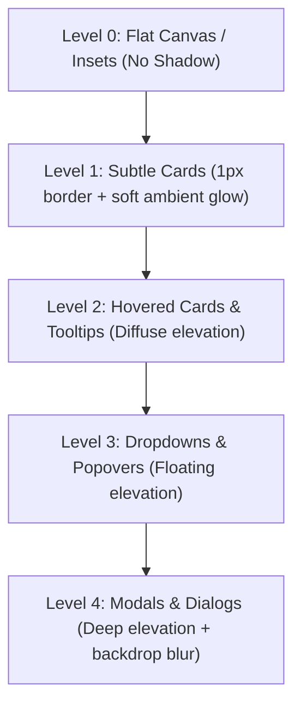

# Professional Visual Design Standards — ui-design-system.md

> **Role & Authority**: Principal Design Systems Architect & Visual Design Director (15+ years of digital product leadership at tier-one technology companies).  
> **Purpose**: Master specification defining how visual foundations—tokens, palettes, typography, spacing, layout, radii, elevation, surfaces, and components—are selected, structured, implemented, and scaled across this project.

---

## Table of Contents
1. [Design System Fundamentals](#1-design-system-fundamentals)
2. [Color Architecture & Token Strategy](#2-color-architecture--token-strategy)
3. [Typography System & Scalable Hierarchy](#3-typography-system--scalable-hierarchy)
4. [Spacing System & Spatial Rhythm](#4-spacing-system--spatial-rhythm)
5. [Layout & Grid Architecture](#5-layout--grid-architecture)
6. [Border Radius System](#6-border-radius-system)
7. [Elevation & Shadow System](#7-elevation--shadow-system)
8. [Borders, Dividers & Boundaries](#8-borders-dividers--boundaries)
9. [Iconography System](#9-iconography-system)
10. [Component Visual Consistency](#10-component-visual-consistency)
11. [Light & Dark Theme Architecture](#11-light--dark-theme-architecture)
12. [Design Tokens & Engineering Implementation](#12-design-tokens--engineering-implementation)
13. [Responsive Visual Foundations](#13-responsive-visual-foundations)
14. [Visual Quality Standards & Audit Checklist](#14-visual-quality-standards--audit-checklist)
15. [Final Operating Principle](#15-final-operating-principle)

---

## 1. Design System Fundamentals

A design system is not a rigid cage that stifles creativity; it is a **shared visual grammar** that accelerates velocity, enforces craftsmanship, and guarantees architectural coherence.

### 1.1. Core Principles
- **Coherent Visual Language**: Every button, input, card, badge, and modal must feel as though it was designed by a single pair of hands with unified intent.
- **Intentional & Reusable Tokens**: Replace arbitrary magic numbers (`top: 17px`, `background: #344152`) with systematic, purposeful tokens.
- **Cohesion Without Monotony**: Consistency does not mean monotonous repetition. Visual foundations adapt to context—distinguishing high-density analytical screens from immersive, celebratory reward surfaces.
- **Respect for Existing Project Conventions**: Before introducing a new token, inspect the existing codebase. Build upon existing font definitions, Tailwind v4 directives, and component conventions. Never introduce an alien framework or redundant system.
- **Lean Architecture**: Do not over-engineer. Avoid 400-token abstractions for a 5-component workflow. Maintain only what is utilized and scalable.

---

## 2. Color Architecture & Token Strategy

Color must never be applied arbitrarily or purely for decoration. Every hue, shade, and alpha channel serves an explicit informational and hierarchical function.

### 2.1. Brand Colors
Brand tokens establish identity, anchor primary interactive workflows, and define key focal points:

| Token Role | Semantic Purpose | Usage Rules |
| :--- | :--- | :--- |
| `color-brand-primary` | Main interactive color, primary actions, key active states | Reserved for primary CTAs and active tab indicators. Never overuse on static backgrounds. |
| `color-brand-secondary` | Supporting brand moments, active chips, badges | Pairs with primary without competing for optical dominance. |
| `color-brand-accent` | High-value focal points, special alerts, highlights | Used sparingly (the 10% in the 60-30-10 rule) to guide the eye. |
| `color-brand-subtle` | Soft brand washes (5%–12% opacity) | Used for selected item backgrounds, subtle tags, or focus glows. |

### 2.2. Neutral Color Foundation
Neutrals provide the structural canvas. Surfaces and content rely on calibrated contrast:

```
SURFACE HIERARCHY (Light Theme)
[ Canvas / Main Bg: #F8FAFC ]
   └── [ Card / Surface: #FFFFFF (border: rgba(0,0,0,0.06)) ]
         └── [ Elevated Surface: #FFFFFF (diffuse shadow + border) ]
               └── [ Inset / Wells: #F1F5F9 ]
```

- **Canvas (`color-bg-canvas`)**: Default base background of the application window.
- **Surface (`color-bg-surface`)**: Primary container background for cards, tables, and sheets.
- **Elevated Surface (`color-bg-elevated`)**: Floated dialogs, popovers, dropdowns, and flyout menus.
- **Muted Inset (`color-bg-subtle`)**: Secondary background for search bars, code blocks, input wells, and disabled fields.
- **Text Primary (`color-text-primary`)**: High-contrast readable text (minimum 9:1 against canvas, e.g., `#0F172A`).
- **Text Secondary (`color-text-secondary`)**: Balanced supporting labels, subtitles, and descriptions (`#475569`).
- **Text Muted (`color-text-muted`)**: Placeholders, metadata timestamps, and tertiary captions (`#94A3B8`).
- **Border Default (`color-border-subtle`)**: Hairline boundary (`rgba(0,0,0,0.07)` or `neutral-200/80`).
- **Border Strong (`color-border-strong`)**: Interactive inputs, active card edges (`neutral-300`).

### 2.3. Semantic Color Tokens
Semantic colors deliver immediate status feedback. Never alter their universal cultural meaning:

- **Success (`#10B981`)**: Confirmations, completed tasks, validated states, positive metric trends.
- **Warning (`#F59E0B`)**: Non-blocking cautions, threshold warnings, pending states, expiring items.
- **Error / Destructive (`#EF5350`)**: Critical failures, destructive confirmation dialogs, inline form errors.
- **Information (`#3B82F6`)**: System notices, passive guidance, tips, active selection outlines.
- **Disabled (`neutral-300` text / `neutral-100` bg)**: Locked states with distinct cursor and reduced opacity.

### 2.4. Color Hygiene Rules
1. **The 60-30-10 Distribution**: 60% neutral surface canvas, 30% structural secondary neutrals, 10% focused accent color.
2. **Accessible Contrast (WCAG 2.1 AA/AAA)**: 
   - Normal text: Minimum 4.5:1 contrast against surface.
   - Large text & icons: Minimum 3.0:1 contrast.
3. **No Gratuitous Gradients**: Gradients are restricted to special celebratory rewards, badges, or brand emblems. Never place text over chaotic multi-stop gradients.
4. **Never Pick Colors on the Fly**: Every color applied in CSS/JSX must trace to a documented theme token.

---

## 3. Typography System & Scalable Hierarchy

Typography is the backbone of interface clarity. A refined typography system conveys scale, mood, and order without requiring heavy graphic ornamentation.

### 3.1. Font Families & Role Pairing
- **Primary Interface Font**: Modern, crisp, neutral sans-serif with excellent micro-legibility (`Inter`, `system-ui`, `-apple-system`). Used for UI controls, inputs, body text, tables, and navigation.
- **Editorial / Accent Font**: Distinctive display serif or geometric font (`Gowun Batang`, `Playfair`, or specialized brand display) reserved exclusively for expressive hero titles, reward values, and celebratory milestones.
- **Monospace Font**: For numeric codes, serial numbers, coordinates, and developer tokens (`JetBrains Mono`, `ui-monospace`).

### 3.2. Typographic Scale & Rhythm
All typographic sizes follow a disciplined proportional ladder:

| Level | Size | Line Height | Tracking | Weight | Recommended Purpose |
| :--- | :--- | :--- | :--- | :--- | :--- |
| **Display 2XL** | `36px` (`2.25rem`) | `1.15` (`leading-tight`) | `-0.03em` | Bold / Black (700/900) | Hero display, major celebratory amounts |
| **Display XL** | `30px` (`1.875rem`)| `1.2` (`leading-tight`)  | `-0.025em`| Bold (700) | Main feature headings |
| **Page Title (H1)**| `24px` (`1.5rem`)  | `1.25` (`leading-snug`)  | `-0.02em` | Semibold/Bold (600/700)| Page headers, primary modal titles |
| **Section Title (H2)**| `20px` (`1.25rem`)| `1.3` (`leading-snug`)  | `-0.015em`| Semibold (600) | Card groups, section dividers |
| **Subheading (H3)**| `16px` (`1rem`)    | `1.4` (`leading-normal`)| `-0.01em` | Medium/Semibold (500/600)| Card titles, table header categories |
| **Body Default** | `14px` (`0.875rem`)| `1.5` (`leading-normal`)| `0em`     | Regular (400) | Default interface text, descriptions |
| **Body Small** | `13px` (`0.8125rem`)| `1.45` (`leading-normal`)| `+0.005em`| Regular/Medium (400/500)| Dense table cells, secondary metadata |
| **Caption / Label**| `12px` (`0.75rem`) | `1.35` (`leading-tight`)| `+0.02em` | Medium (500) | Form labels, helper captions |
| **Micro / Badge** | `10px` (`0.625rem`)| `1.2` (`leading-none`)  | `+0.05em` | Bold (700, uppercase) | Status tags, coin badges, counter pills |

### 3.3. Typography Rules
- **Measure (Line Length)**: Restrict continuous reading blocks to 45–75 characters (max ~600px).
- **Proportional Tracking**: Negative tracking on large headings keeps characters tight and cohesive; positive tracking on micro uppercase labels ensures crisp scannability.
- **Never Step 1px**: Never use 13px and 14px interchangeably within the same visual group. Make size jumps deliberate and meaningful.
- **Tabular Numerals**: Use `font-variant-numeric: tabular-nums` (`tabular-nums` in Tailwind) for countdown timers, currency amounts, coin tallies, and financial tables to prevent jitter during updates.

---

## 4. Spacing System & Spatial Rhythm

Consistent spatial cadence produces immediate visual harmony. Space is not passive emptiness; it is an active tool that groups related elements and separates distinct concepts.

### 4.1. Base-Unit Discipline (The 4pt / 8pt Grid)
All spacing, padding, margins, gutters, and dimensional bounds must adhere to multiples of 4px:

```
 4px (0.25rem)  ── Micro gaps, icon-to-text spacing, inline tag padding
 8px (0.5rem)   ── Compact padding, input internal padding (y-axis), list gaps
12px (0.75rem)  ── Control padding (x-axis), item cluster gaps
16px (1.0rem)   ── Standard card padding, component margins, form group spacing
20px (1.25rem)  ── Generous card padding, medium section gaps
24px (1.5rem)   ── Modal dialog padding, container margins
32px (2.0rem)   ── Major section separation, grid gutters
40px (2.5rem)   ── Large layout gaps, page header margins
48px (3.0rem)   ── Page-level vertical rhythms
64px+ (4.0rem+) ── Landing page hero section buffers
```

### 4.2. Application-Specific Spacing Guidance
- **Inline Elements (Icon + Text)**: Strict 6px–8px gap (`gap-1.5` to `gap-2`).
- **Form Groups**: 16px vertical gap between distinct fields (`space-y-4`); 6px between label and its control (`space-y-1.5`).
- **Card Padding**: Compact mobile cards: 12px–16px (`p-3` to `p-4`); Desktop cards: 20px–24px (`p-5` to `p-6`).
- **Page Container Margins**: Mobile: 16px gutters (`px-4`); Tablet: 24px gutters (`px-6`); Desktop: 32px gutters (`px-8`).

---

## 5. Layout & Grid Architecture

Layout architecture dictates how content flows across viewports, preventing awkward stretching on large monitors or cramped collision on mobile screens.

### 5.1. Container Maximum Widths
Content must be bound within calibrated containers to maintain optimal scan lines:

| Container Token | Max Width | Best Suited For |
| :--- | :--- | :--- |
| `max-w-xs` / `max-w-sm` | `320px – 384px` | Focused mobile dialogs, verification cards, login forms |
| `max-w-md` / `max-w-lg` | `448px – 512px` | Reward sheets, checkout flows, settings modals |
| `max-w-2xl` / `max-w-3xl` | `672px – 768px` | Articles, document readers, linear form wizards |
| `max-w-5xl` / `max-w-6xl` | `1024px – 1152px` | Standard web applications, dashboard overviews |
| `max-w-7xl` | `1280px` | High-density operational consoles, wide data tables |

### 5.2. Screen Density Archetypes
- **High-Density Operational (e.g., POS, Trading, Analytics)**:
  - Tightly grouped controls (8px–12px padding).
  - Maximized viewport utilization, sticky toolbars, high-volume data tables.
- **Spacious Consumer / Gamified (e.g., Tomo Rewards, Onboarding)**:
  - Centered mobile-viewport simulators or fluid adaptive cards (16px–24px padding).
  - Elevated visual breathing room, generous touch targets, expressive typography.

### 5.3. Grid and Column Systems
- **Mobile (< 640px)**: 1-column linear vertical stack.
- **Tablet (640px – 1024px)**: Adaptive 2-column or 3-column symmetric grid (`grid-cols-2` or `grid-cols-3`).
- **Desktop (1024px+)**: 12-column responsive grid with flexible sidebars (`grid-cols-12`, with sidebar taking 3 columns and main canvas taking 9 columns).

---

## 6. Border Radius System

Corner curvature establishes the tactile character of the UI. Curvature must follow an explicit hierarchy from smallest inner elements to large outer containers.

```
+--------------------------------------------------------------+
| OUTER MODAL DIALOG / CONTAINER: rounded-2xl (16px)           |
|                                                              |
|   +------------------------------------------------------+   |
|   | NESTED CARD: rounded-xl (12px)                       |   |
|   |                                                      |   |
|   |   +------------------------+  +------------------+   |   |
|   |   | INPUT: rounded-lg (8px)|  | BTN: rounded-lg  |   |   |
|   |   +------------------------+  +------------------+   |   |
|   +------------------------------------------------------+   |
|                                                              |
|   TAG: rounded-full (9999px)                                 |
+--------------------------------------------------------------+
```

### 6.1. Radius Hierarchy Scale
- `rounded-sm` (`4px`): Micro tooltips, checkbox controls, inline code chips.
- `rounded-md` (`6px`): Compact dropdown items, segment controls, small badges.
- `rounded-lg` (`8px`): Standard buttons, text inputs, search fields, select menus.
- `rounded-xl` (`12px`): Cards, content panels, interactive tiles, floating banners.
- `rounded-2xl` (`16px`): Large modal dialogs, bottom sheets, mobile viewport shells.
- `rounded-3xl` (`24px`): Hero cards, prominent feature banners.
- `rounded-full` (`9999px`): Avatars, status pills, circular icon buttons, coin tokens.

### 6.2. The Concentric Curvature Rule
When nesting a rounded card inside a rounded container:
$$\text{Inner Radius} \approx \text{Outer Radius} - \text{Padding}$$
*Example*: If an outer modal has `rounded-2xl` (16px) and 8px padding, the inner element should have `rounded-lg` (8px). Mismatched radii produce jarring optical corners.

---

## 7. Elevation and Shadow System

Shadows mimic natural ambient light, creating depth and hierarchy. Avoid harsh, murky, single-stop black shadows.



### 7.1. Calibrated Multi-Stop Shadow Tokens
- **Elevation 0 (Flat)**: `box-shadow: none;` — Canvas, resting table rows, subtle wells.
- **Elevation 1 (Card / Subtle)**:  
  `box-shadow: 0 1px 2px 0 rgba(0, 0, 0, 0.05);`  
  Paired with a 1px border (`border-neutral-200/70`).
- **Elevation 2 (Floating / Hover)**:  
  `box-shadow: 0 4px 6px -1px rgba(0, 0, 0, 0.07), 0 2px 4px -2px rgba(0, 0, 0, 0.05);`  
  Used for card hovers, active chips, and floating action buttons.
- **Elevation 3 (Dropdown / Popover)**:  
  `box-shadow: 0 10px 15px -3px rgba(0, 0, 0, 0.08), 0 4px 6px -4px rgba(0, 0, 0, 0.04);`  
  Used for select menus, autocomplete lists, and contextual tooltips.
- **Elevation 4 (Modal / Dialog)**:  
  `box-shadow: 0 20px 25px -5px rgba(0, 0, 0, 0.1), 0 8px 10px -6px rgba(0, 0, 0, 0.04);`  
  Used for center modals, bottom sheets, and alerts paired with `backdrop-blur-sm bg-black/40`.

---

## 8. Borders, Dividers & Boundaries

Borders delineate boundaries when background contrast alone is insufficient.

### 8.1. Border Tokens & Weights
- **Hairline Border (`1px`)**: Default boundary for all cards, inputs, and dividers (`border border-neutral-200/80`).
- **Heavy / Active Border (`2px`)**: Exclusively for active states, selected radio/checkbox cards, or focused input rings.
- **Never Use 3px+ Borders**: Unless styling an intentional retro/neo-brutalist theme, borders $>2\text{px}$ add clunky weight.

### 8.2. Dividers
- Prefer subtle alpha dividers (`border-neutral-100` or `divide-neutral-100`) rather than solid dark lines.
- Where spatial proximity clearly indicates separation, omit dividers entirely in favor of whitespace.

---

## 9. Iconography System

Icons are visual accelerators that facilitate instant scanning. They must never be used as gratuitous decorative confetti.

### 9.1. Icon Standards
- **Unified Library**: Use a single, cohesive icon set across the product (e.g., Lucide React, Phosphor, Heroicons). Never mix disparate libraries with clashing geometry.
- **Consistent Stroke Weight**: Standardize on a uniform 1.5px or 2px stroke weight (`stroke-[1.75]`). Do not mix filled and outlined icons haphazardly unless filled indicates the active state.
- **Calibrated Sizing Scale**:
  - `14px` (`size-3.5`): Inline metadata, micro status dots.
  - `16px` (`size-4`): Form input indicators, secondary button icons.
  - `20px` (`size-5`): Standard button icons, navigation rail icons.
  - `24px` (`size-6`): Modal header anchors, card feature badges.
  - `32px – 48px` (`size-8` to `size-12`): Empty state illustrations, major status banners.
- **Optical Alignment**: Always vertically center icons against adjacent text (`inline-flex items-center gap-2`).

---

## 10. Component Visual Consistency

Every component must share foundational design DNA. Detailed interaction behavior is governed by `component-guidelines.md`, but visual styling conforms to these standards:

| Component | Height / Size | Radius | Border & Elevation | Text Scale |
| :--- | :--- | :--- | :--- | :--- |
| **Primary Button** | `36px – 40px` (`h-9`–`h-10`) | `rounded-lg` (8px) | 1px brand border, subtle top highlight | `text-sm font-medium` |
| **Secondary Button** | `36px – 40px` (`h-9`–`h-10`) | `rounded-lg` (8px) | 1px neutral border, surface bg | `text-sm font-medium` |
| **Text Input** | `36px – 40px` (`h-9`–`h-10`) | `rounded-lg` (8px) | 1px border-neutral-300, focus:ring-2 | `text-sm font-normal` |
| **Standard Card** | Flexible | `rounded-xl` (12px)| 1px border-neutral-200/80, Elevation 1 | Title `text-base font-semibold` |
| **Badge / Tag** | `20px – 24px` (`h-5`–`h-6`) | `rounded-full` (pills)| None or 1px subtle tint | `text-xs font-semibold` |
| **Modal Dialog** | Max `512px` | `rounded-2xl` (16px)| 1px border-neutral-200, Elevation 4 | Title `text-lg font-bold` |

---

## 11. Light and Dark Theme Architecture

When supporting light and dark modes, never perform a naive mathematical inversion (e.g., turning `#FFFFFF` into `#000000`).

### 11.1. Dark Mode Principles
1. **Surfaces Step Forward with Luminance**: In dark mode, higher elevation corresponds to **lighter surface tints** (not darker shadows):
   - Background Canvas: Deepest neutral (`#090D16` or `#0F172A`).
   - Resting Cards: Slightly elevated neutral (`#1E293B`).
   - Floating Modals/Dropdowns: Higher luminance neutral (`#334155`).
2. **Desaturate Accent Colors**: High-saturation accents that look vibrant on white background cause eye strain and visual vibration on dark backgrounds. Slightly desaturate accents in dark mode.
3. **Replace Drop Shadows with Hairline Borders**: Shadows disappear against dark canvases. Define depth using 1px translucent borders (`border-white/10` or `border-white/15`).
4. **Preserve Legibility**: Primary text should be an off-white (`#F8FAFC` or `#F1F5F9`), not glaring pure `#FFFFFF`.

---

## 12. Design Tokens & Engineering Implementation

Design tokens translate visual design principles into maintainable production code.

### 12.1. Tailwind CSS v4 Theme Architecture
In this project (Tailwind CSS v4), tokens are declared centrally in `src/index.css` using the `@theme` directive, or as CSS custom properties on `:root`:

```css
@import 'tailwindcss';

@theme {
  /* Color Tokens */
  --color-brand-primary: #3B82F6;
  --color-brand-success: #10B981;
  --color-brand-error: #EF5350;
  
  /* Font Family Tokens */
  --font-sans: 'Inter', system-ui, -apple-system, sans-serif;
  --font-display: 'Gowun Batang', Georgia, serif;
  
  /* Radii Tokens */
  --radius-sm: 4px;
  --radius-md: 6px;
  --radius-lg: 8px;
  --radius-xl: 12px;
  --radius-2xl: 16px;
}

:root {
  --canvas-bg: #F8FAFC;
  --surface-bg: #FFFFFF;
  --text-main: #0F172A;
  --text-muted: #64748B;
  --border-subtle: rgba(15, 23, 42, 0.08);
}
```

### 12.2. Engineering Invariants
- **No Scattered Hardcoded Values**: Do not write random arbitrary classes like `text-[17.5px]` or `bg-[#3f2a89]` in ad-hoc components when a standard theme token exists.
- **Maintainable Naming**: Use semantic role names (`--color-text-secondary`) rather than appearance names (`--color-gray-600`).
- **Zero Duplicate Systems**: Do not import external CSS libraries (Bootstrap, Chakra) on top of the established Tailwind v4 setup.

---

## 13. Responsive Visual Foundations

Tokens must seamlessly scale between compact mobile screens and expansive desktop monitors.

### 13.1. Fluid & Breakpoint Behavior
- **Fluid Typography**: Use responsive classes (e.g., `text-xl sm:text-2xl lg:text-3xl`) so headings do not overwhelm mobile viewports.
- **Adaptive Spacing**: Reduce large layout paddings on mobile (e.g., `p-4 sm:p-6 lg:p-8`).
- **Touch-Friendly Controls**: Ensure buttons and touch targets maintain a minimum dimension of $44\times 44\text{px}$ on touch viewports (`< 640px`), even if their visual footprint uses compact padding.

---

## 14. Visual Quality Standards & Audit Checklist

Before declaring any design system foundation or styled view complete, perform this 9-point audit:

- [ ] **Palette Harmony**: Does the color palette respect the 60-30-10 distribution without clashing accents?
- [ ] **Contrast Compliance**: Do all text and interactive controls meet WCAG 2.1 AA ratios (4.5:1 text, 3:1 graphical)?
- [ ] **Typographic Scale**: Does every heading, body, and caption element map to a clear step on the typographic ladder?
- [ ] **Spacing Discipline**: Are all margins, paddings, and gaps multiples of 4px?
- [ ] **Proportional Balance**: Do nested containers respect the Concentric Curvature Rule?
- [ ] **Elevation Restraint**: Are shadows diffuse and subtle, paired with 1px hairline borders?
- [ ] **Brand Identity Support**: Does the visual treatment elevate the specific personality of this product?
- [ ] **Systemic Reusability**: Are all styles backed by documented tokens rather than arbitrary one-off values?
- [ ] **Cross-Device Integrity**: Has the view been verified at 375px (mobile), 768px (tablet), and 1280px (desktop)?

---

## 15. Final Operating Principle

Build a visual design system that is:
- **Consistent without being repetitive.**
- **Flexible without being chaotic.**
- **Sophisticated without being unnecessarily complex.**
- **Modern without being trend-dependent.**
- **Reusable without sacrificing creativity.**
- **Beautiful without compromising usability.**

**Every visual value must serve a purpose. Every design token must contribute to a coherent product experience.**
