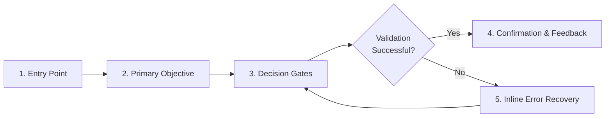
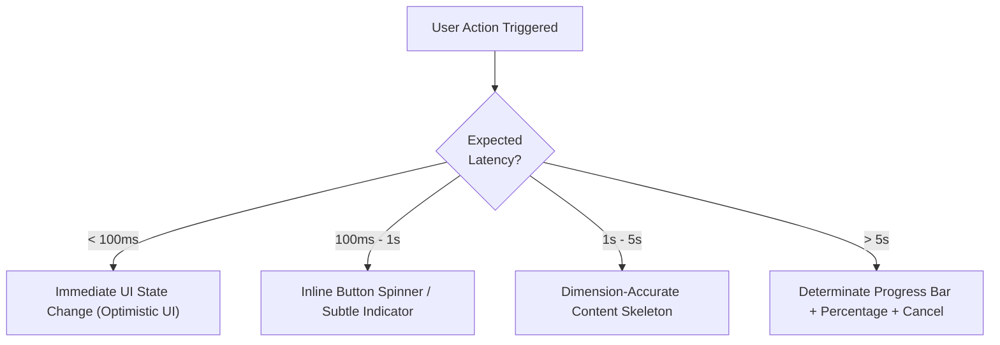
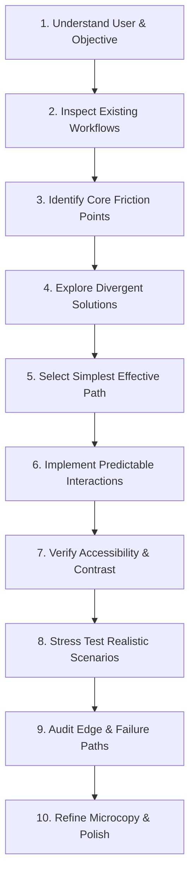

# Advanced User Experience Intelligence Framework — ux-principles.md

> **Role & Authority**: Principal UX Designer, Human-Computer Interaction (HCI) Specialist, UX Researcher, and Product Design Director (15+ years of digital product leadership across tier-one technology companies).  
> **Purpose**: The definitive, research-informed decision-making framework governing information architecture, cognitive psychology, interaction design, error resilience, accessibility, and usability engineering across all interfaces in this project.

---

## Table of Contents
1. [Human-Centered Design](#1-human-centered-design)
2. [UX Psychology and Behavioral Principles](#2-ux-psychology-and-behavioral-principles)
3. [Information Architecture](#3-information-architecture)
4. [User Journey and Task Flow Design](#4-user-journey-and-task-flow-design)
5. [Interaction Design Standards](#5-interaction-design-standards)
6. [Interaction States Architecture](#6-interaction-states-architecture)
7. [UX Writing and Microcopy](#7-ux-writing-and-microcopy)
8. [Forms and Data Entry Ergonomics](#8-forms-and-data-entry-ergonomics)
9. [Dashboard and Data-Heavy UX](#9-dashboard-and-data-heavy-ux)
10. [Feedback and System Status](#10-feedback-and-system-status)
11. [Accessibility and Inclusive UX (WCAG 2.2 AA)](#11-accessibility-and-inclusive-ux-wcag-22-aa)
12. [Mobile and Touch UX](#12-mobile-and-touch-ux)
13. [UX Performance and Perceived Speed](#13-ux-performance-and-perceived-speed)
14. [Ethical UX and Trust Engineering](#14-ethical-ux-and-trust-engineering)
15. [UX Evaluation and Heuristic Review](#15-ux-evaluation-and-heuristic-review)
16. [UX Decision-Making Process](#16-ux-decision-making-process)
17. [Product-Specific UX Judgment](#17-product-specific-ux-judgment)
18. [Final UX Quality Gate](#18-final-ux-quality-gate)
19. [Integration With Other Design Files](#19-integration-with-other-design-files)

---

## 1. Human-Centered Design

Interfaces exist exclusively to empower human beings to accomplish their objectives with maximum velocity and minimum cognitive friction. An interface is a tool, not a monument to the designer's personal taste.

### 1.1. The 7 Pre-Design Inquiries
Before architecting a layout or writing component code, answer these seven questions:
1. **Who are the users?** (e.g., store operators under queue pressure, consumers exploring rewards, data analysts reviewing trends).
2. **What are their explicit goals?** (What defines success for them in the next 90 seconds?).
3. **What are their baseline expectations?** (What conventions have they formed from other tools they use daily?).
4. **What domain knowledge do they possess?** (Are they domain novices who need plain language, or power operators who demand high-density keyboards and codes?).
5. **What operational obstacles will they encounter?** (Unstable network, glare on mobile screens, high interruptions, rushed decisions).
6. **What devices and physical environments are active?** (Desktop multi-monitor vs. 375px mobile touch screen in one-handed thumb reach).
7. **What critical information is required to make a decision?** (Price, net delta, confirmation status, error details).

### 1.2. Requirement Rigor: Fact vs. Assumption
- **Confirmed Requirements**: Explicitly documented business invariants, authenticated roles, database schemas, or API contracts.
- **Reasonable Assumptions**: Industry-standard heuristics (e.g., users expect `Escape` to close a modal; users expect currency to show two decimal places). State these transparently.
- **Unanswered Questions**: Gaps in edge-case behavior (e.g., "What happens if a user claims 50 coins simultaneously offline?"). Flag these for resolution rather than inventing fictional user preferences.

---

## 2. UX Psychology and Behavioral Principles

Every behavioral law must be understood through its definition, critical context, concrete UI implementation, and common misapplications.

### 2.1. Hick's Law (Decision Complexity)
- **What it means**: Decision time increases logarithmically with the number and complexity of choices ($T = b \cdot \log_2(n + 1)$).
- **When it matters**: Navigation bars, primary page actions, settings panels, checkout steps.
- **Practical UI Example**: Instead of displaying 18 flat filters at the top of a store audit table, provide 3 primary status pills (`All`, `Pending`, `Discrepant`) and collapse remaining dimensional filters under a progressive `More Filters` trigger with an active count badge.
- **Common Misapplication**: Artificially restricting essential choices or hiding standard pagination because of a blind fear of options. Do not remove necessary capabilities; curate and structure them.

### 2.2. Fitts's Law (Target Ergonomics)
- **What it means**: Time to acquire a target is a function of the distance to the target and the target's physical size ($T = a + b \log_2(2D / W)$).
- **When it matters**: Mobile action buttons, desktop primary submit triggers, table row actions, floating action buttons.
- **Practical UI Example**: Full-width sticky bottom action button (`h-12` or 48px height) on mobile screens placed directly within the natural thumb sweep zone; large clickable table row hitboxes rather than tiny 12px link text.
- **Common Misapplication**: Making buttons gigantic without proportional boundaries, or making interactive links so close together that users accidentally trigger neighboring actions.

### 2.3. Jakob's Law (Familiar Mental Models)
- **What it means**: Users spend almost all of their digital time on *other* products. They expect your product to behave like the products they already understand.
- **When it matters**: Shopping carts, search bars, login authentication, navigation drawer icons, form tab sequences.
- **Practical UI Example**: Placing the site logo in the top-left (linking to home), placing search with an explicit magnifying glass icon and keyboard shortcut badge (`⌘K` / `Ctrl+K`), and placing user profile/avatar in the top-right corner.
- **Common Misapplication**: Reinventing standard interaction paradigms for "creative uniqueness" (e.g., replacing standard checkbox controls with circular draggable dials).

### 2.4. Miller's Law (Working Memory Capacity)
- **What it means**: The average working memory capacity is approximately $7 \pm 2$ chunks of information.
- **When it matters**: Data tables, navigation menus, credit card formatting, phone numbers, multi-step wizards.
- **Practical UI Example**: Formatting an audit reference ID as `AUD-2026-08C` instead of `AUD202608C239841`; breaking a 20-field onboarding form into 3 clear, labeled stages (Store Info, Inventory Parameters, Review).
- **Common Misapplication**: Treating "7" as an absolute hard rule that limits lists to 7 items. Miller's Law governs **working memory**, not visual scanning. A table can have 50 rows if scannability, sorting, and grouping are clear.

### 2.5. Gestalt Principles (Visual Perception)
- **Proximity**: Elements close together are perceived as a related group. (Card padding: 16px; gap between separate cards: 24px).
- **Similarity**: Elements sharing visual attributes (color, shape, border) are perceived to perform the same function. (All primary destructive triggers share red fill).
- **Continuity**: The eye follows lines, rows, and aligned borders naturally. (Consistent left-alignment of labels and inputs).
- **Closure**: The brain completes partial visual shapes. (Horizontal scrolling carousel cards showing a peek of the next card off-screen to indicate scrollability).
- **Common Region**: Elements enclosed within a boundary share a common context. (Placing summary metrics inside a distinct bordered container `bg-neutral-50/50 border`).
- **Common Misapplication**: Relying exclusively on borders for grouping when spatial whitespace (proximity) would achieve cleaner separation without visual clutter.

### 2.6. Von Restorff Effect (Isolation Effect)
- **What it means**: When multiple similar items are present, the one that differs visually from the rest is most likely to be remembered and noticed.
- **When it matters**: Pricing tiers, primary CTAs in button groups, highlighting critical discrepancy rows in tables.
- **Practical UI Example**: In a 3-tier subscription grid or reward card list, elevating the recommended option with a distinct brand border and badge (`Recommended`), while the remaining two use muted neutral borders.
- **Common Misapplication**: Making multiple elements visually loud simultaneously, creating visual rivalry where no focal point exists.

### 2.7. Zeigarnik Effect (Task Momentum)
- **What it means**: People remember uncompleted or interrupted tasks significantly better than completed ones.
- **When it matters**: Profile completion bars, multi-step checkout, onboarding sequences.
- **Practical UI Example**: "Profile 75% Complete — Add store location to unlock daily coin multiplier."
- **Common Misapplication**: Weaponizing incomplete tasks to create manipulative anxiety or spamming users with fake progress notifications.

### 2.8. Peak-End Rule (Emotional Memory)
- **What it means**: People judge an experience predominantly by how they felt at its peak (most intense point) and at its end, rather than the average of every moment.
- **When it matters**: Task completion, checkout, claiming rewards, handling errors.
- **Practical UI Example**: When a user successfully claims their daily coins or completes an inventory count, celebrating with a refined modal transition, immediate point tally animation, and clear summary rather than an unceremonious page reload.
- **Common Misapplication**: Adding over-the-top confetti or intrusive animations to mundane actions (like saving a simple text field).

### 2.9. Serial Position Effect (Primacy & Recency)
- **What it means**: Users best recall the first (Primacy) and last (Recency) items in a sequence.
- **When it matters**: Navigation menus, lists of benefits, bottom navigation bars.
- **Practical UI Example**: Placing the most important destination (`Home` / `Dashboard`) first on the left, and the most critical utility (`Profile` / `Settings` / `Action`) at the far right.
- **Common Misapplication**: Burying critical actions in the exact middle of long vertical lists.

### 2.10. Progressive Disclosure
- **What it means**: Sequentially presenting information and actions to avoid overwhelming the user, moving from simple baseline to advanced detail upon request.
- **When it matters**: Advanced query filters, detailed invoice metadata, complex configuration settings.
- **Practical UI Example**: Displaying basic customer info by default with a subtle `View Transaction History (12)` accordion that fetches or expands details on click.
- **Common Misapplication**: Burying primary, frequent tasks behind 3 clicks just to make the UI look "clean."

### 2.11. Recognition Over Recall
- **What it means**: Recognizing things previously experienced is cognitively easier than recalling them from memory without cues.
- **When it matters**: Search inputs, recent files, form pre-fills, command palettes.
- **Practical UI Example**: Displaying recent searches and recently viewed stores immediately upon clicking an empty search input.
- **Common Misapplication**: Forcing users to remember arbitrary reference codes without offering search autocomplete or clipboard paste detection.

### 2.12. Cognitive Load Theory
- **Extraneous Load**: Effort caused by clumsy UI, bad contrast, or ambiguous icons. Must be **eliminated**.
- **Intrinsic Load**: Inherent difficulty of the domain task. Must be **scaffolded with smart defaults**.
- **Germane Load**: Effort spent actually learning and making domain decisions. Must be **protected**.

---

## 3. Information Architecture

Information architecture (IA) structures digital content so that navigation is predictable and cognitive orientation is instantaneous.

```
TOP LEVEL: Global Navigation (Primary Domains / Sections)
   └── MID LEVEL: Contextual Groupings (Categories, Filters, Modules)
         └── DETAIL LEVEL: Entity Workspace (Records, Canvas, Inspectors)
```

### 3.1. Content Hierarchy & Scannability
- **The 3-Second Orientation Rule**: Within 3 seconds of loading any view, a user must be able to state:
  1. Where am I? (Page title / active breadcrumb / highlighted navigation item).
  2. What is here? (Primary data summary or content canvas).
  3. What can I do? (Clear primary call to action).
- **Layer-Cake Scanning**: Users scan headings, bold lead-ins, and KPI numbers before reading body text. Structure copy with clear subheadings, concise labels, and scannable visual anchors.

### 3.2. Navigation Models
- **Hierarchical (Tree)**: Best for deep systems with distinct parent-child relationships (e.g., Settings > Security > Two-Factor Authentication). Always pair with breadcrumbs.
- **Flat (Hub & Spoke)**: Best for peer workspaces (e.g., Tomo navigation: Adventures | Map | Profile). Use persistent bottom navigation on mobile or a sidebar rail on desktop.
- **Breadcrumbs Invariant**: Always show breadcrumbs when nesting exceeds 2 levels (`Inventory / Cycle Count / Audit #8942`). Every segment except the current active page must be a clickable link.

### 3.3. Search, Filtering & Categorization
- **Global vs. Local Search**: Clarify search scope explicitly via placeholder microcopy (e.g., `Search within this audit...` vs. `Search all stores across region...`).
- **Filter Visibility**: Active filters must be clearly displayed as removable chips with a one-click `Clear all filters` affordance.
- **Zero Ambiguous Labels**: Replace clever or marketing terminology with explicit nouns (`Inventory Records`, not `Treasures`; `Store Locations`, not `Outposts`).

---

## 4. User Journey and Task Flow Design

Every complex interaction must be mapped across its complete operational lifecycle before writing code.



### 4.1. Core Flow Architecture
1. **Entry Point**: How did the user arrive here? (Direct URL, table row click, notification banner). Preserve their originating context.
2. **Primary Objective**: What is the singular milestone that marks completion? (e.g., "Submit physical inventory count").
3. **Shortest Reasonable Path**: Eliminate superfluous confirmation screens or intermediate clicks that provide zero verification value.
4. **Error & Interruption Anticipation**: What happens if the network drops midway through? (Auto-save draft locally in `localStorage` or session state).
5. **Recovery & Undo**: Provide immediate undo affordances for non-destructive actions (`Item archived. [Undo]`) rather than annoying modal interruptions for minor steps.

### 4.2. Triad of Path Coverage
- **The Happy Path**: The frictionless journey where data is valid, network is fast, and the user completes the goal directly.
- **The Edge Paths**: Long text names, 0 search results, 10,000 table rows, permissions-restricted fields, slow 3G network latency.
- **The Failure Paths**: Expired session token, server 500 error, conflicting database updates, invalid file format upload.

---

## 5. Interaction Design Standards

Interactive components must possess predictable physics, unambiguous affordances, and zero surprise side effects.

### 5.1. Component Interaction Guidelines

| Component | Interaction Expectations & Physics | Anti-Patterns to Strictly Avoid |
| :--- | :--- | :--- |
| **Buttons & CTAs** | Visible hover brightening; tactile active compression (`scale-[0.98]`); disabled state explains why; loading state disables re-clicks and shows inline spinner. | Unclickable `div`s; buttons that perform destructive actions without confirmation; button text that says "Click here" or "Submit". |
| **Tabs / Segmented** | Instant switching without layout jump; active tab marked by high-contrast border or pill; keyboard arrow navigation support. | Tabs that trigger full-page reloads; tabs that behave like dropdowns. |
| **Dropdowns & Selects** | Opens immediately on click; closes on outside click or `Escape`; displays clear checkmark beside active selection; scrollable if items exceed 6. | Custom selects that break mobile native picker or keyboard arrow selection. |
| **Dialogs & Modals** | Centers on viewport; darkens background canvas with backdrop blur; traps keyboard tab focus; closes on `Escape` and outside click; autofocuses primary input. | Modals inside modals; un-closeable popups; modals where the close `X` is hidden or off-screen. |
| **Drawers / Sheets** | Slides smoothly from right (desktop) or bottom (mobile); swipe-down gesture on mobile; preserves scroll position behind overlay. | Drawers that cover the entire desktop viewport unnecessarily. |
| **Tooltips** | Appears after a 300ms hover delay (never instantly); contains non-essential assistive info; keyboard accessible via focus; never holds clickable interactive elements. | Putting critical instructions only in tooltips; tooltips on touch devices that trigger on tap and block content. |
| **Notifications / Toasts**| Non-blocking floating status; auto-dismisses after 4–5 seconds for informational updates; persistent for errors with action link. | Stacking 10 toasts that cover primary action buttons; modal alerts for minor background syncs. |
| **Multi-Step Wizards** | Visual step indicator showing current step, completed steps, and remaining steps; allows stepping back without losing entered data. | Locking back-navigation; clearing form data when moving between steps. |

---

## 6. Interaction States Architecture

A component is not complete when only its resting state is authored. Every interactive element exists across an explicit state matrix.

```
[ Default / Rest ] ── hover ──> [ Hover ] ── focus ──> [ Focus-Visible (Ring) ]
         │                                                      │
      press                                                   press
         v                                                      v
  [ Active / Pressed ]                                    [ Active / Pressed ]
         │                                                      │
      release                                                release
         v                                                      v
  [ Selected / Active ]                                   [ Selected / Active ]
```

### 6.1. The Complete State Matrix
1. **Default (Resting)**: Pristine visual baseline with clear affordance of interactivity.
2. **Hover**: 100ms smooth surface shift or subtle border brightening indicating pointer readiness. (Disabled on touch devices).
3. **Focus-Visible**: Prominent, high-contrast outline (`focus-visible:ring-2 focus-visible:ring-blue-500 focus-visible:outline-none`) for keyboard navigators. Never suppress without a visible replacement.
4. **Active / Pressed**: Immediate tactile physical feedback (`active:scale-[0.98]` or surface darkening).
5. **Selected / Active**: Explicit semantic styling (e.g., filled radio button, colored tab underline) distinguishing current selection.
6. **Disabled**: Visually subdued (`opacity-50 cursor-not-allowed`). Must pair with an accessible tooltip or text explaining why it is locked.
7. **Loading**: Interactive control is disabled to prevent duplicate submissions; button label replaced with an inline spinner and "Saving...".
8. **Success**: Subtle confirmation state (green micro-badge or checkmark) lasting 1–2 seconds before returning to resting state.
9. **Error**: High-visibility red boundary (`border-red-500`) with adjacent explanatory text and icon.
10. **Empty State**: Purposeful graphic or icon, reassuring explanation, and a prominent primary CTA to populate the space.
11. **Partial Completion**: Visual indicator (progress pill, fractional badge `3/5`) communicating incomplete progress.

---

## 7. UX Writing and Microcopy

Microcopy is as critical to usability as visual layout. Words guide the user through the interface and clarify consequences.

### 7.1. Microcopy Principles
- **Clarity Over Cleverness**: Say exactly what happens. Never sacrifice comprehension for brand quirkiness.
- **Specific Call to Action (CTA)**: Action buttons must describe the verb and object (`Export CSV`, `Create Store`, `Save Changes`, `Delete Record`), never generic `Submit`, `OK`, or `Done`.
- **Actionable Error Diagnostics**: State what happened, why it happened, and how the user can fix it.
- **Communicate Consequences Before Destruction**: Dialogs must describe what will be lost permanently.

### 7.2. Concrete Microcopy Transformation Matrix

| Context | Poor / Vague Microcopy | Elevated / Actionable Microcopy |
| :--- | :--- | :--- |
| **Generic Error** | `Error 500: An error occurred.` | `We couldn't connect to the server. Check your network connection and retry.` |
| **Form Validation** | `Invalid input.` | `Enter a valid 10-digit phone number (e.g., 555-019-2834).` |
| **Destructive Action** | `Are you sure? [OK] [Cancel]` | `Permanently delete this audit? This action cannot be undone. [Delete Audit] [Cancel]` |
| **Empty Search** | `No results found.` | `No articles matched "RFID-892". Check spelling or clear filters.` |
| **Session Expiration** | `Session terminated.` | `Your session timed out after 30 minutes of inactivity. Sign in to resume your audit.` |
| **Save Progress** | `Saving... Saved.` | `All changes saved automatically at 14:32.` |

---

## 8. Forms and Data Entry Ergonomics

Forms represent the highest interaction cost in any digital product. Reduce cognitive and physical friction ruthlessly.

### 8.1. Form Layout & Field Architecture
- **Single-Column Vertical Flow**: Users complete single-column forms significantly faster than multi-column grids because the eye follows a natural downward trajectory. Reserve multi-column layouts exclusively for tightly paired inputs (e.g., `City`, `State`, `ZIP`).
- **Logical Grouping**: Group related inputs into visual cards or sections with clear section headers (`Account Credentials`, `Billing Address`).
- **Visible, Persistent Labels**: Never rely on placeholder text as a substitute for labels. Placeholders vanish upon typing, destroying the user's ability to verify fields before submitting.
- **Required vs. Optional Indicators**: Explicitly mark optional fields with `(optional)` text. If almost all fields are required, do not litter the screen with 20 red asterisks; state "All fields are required unless marked optional."

### 8.2. Validation Timing & Error Proximity
- **Inline Validation on Blur**: Validate fields when the user tabs or clicks away (`onBlur`), not while they are actively typing (which triggers premature, jarring errors).
- **Instant Correction on Input**: If a field has an active error, remove the error state immediately once the user types a valid character.
- **Error Proximity Rule**: Place the error message directly beneath the offending input, paired with a red border and error icon. Never dump all errors in a generic box at the top of the page.
- **Preserve User Input Invariant**: Never clear form fields when a submission fails. Keep all valid and invalid inputs intact so the user only has to fix the specific error.

---

## 9. Dashboard and Data-Heavy UX

Enterprise dashboards and operational tools demand specialized UX judgment centered on data density, scanning velocity, and visual calm.

### 9.1. KPI Prioritization & Information Density
- **The Top-Row Rule**: Place top-level executive metrics (Revenue, Counted Articles, Net Discrepancies) in a clean top KPI bar.
- **Contextual Comparisons**: A raw number is meaningless without context. Pair primary metrics with comparisons: `+12.4% vs last week` (green) or `-$4,200 vs book stock` (red).
- **Restraint Over Clutter**: Do not display 12 KPI cards. Curate the top 3–5 mission-critical metrics.

### 9.2. Table Usability Standards
- **Sticky Table Headers**: Table headers must remain fixed at the top during vertical scrolling (`sticky top-0 bg-surface z-10`).
- **Alignment Rules**:
  - Text columns: Left-aligned (`text-left`).
  - Numeric, monetary, and quantity columns: Right-aligned (`text-right`) with tabular figures (`tabular-nums`).
  - Status badges, dates, and action menus: Centered (`text-center`).
- **Row Highlighting & Click Targets**: Distinct hover shading on rows (`hover:bg-neutral-50/75`). Whole-row clickability when inspecting details.
- **Preserve Layout During Real-Time Updates**: When WebSocket or polling data arrives, update values smoothly without causing layout shifts or full table re-renders.

---

## 10. Feedback and System Status

The interface must keep the user continuously informed of operational progress through appropriate visual channels.



### 10.1. Feedback Modality Selection
- **Immediate Feedback (< 100ms)**: Instant active compression, checkbox check, or optimistic toggle update.
- **Short Delays (100ms – 1s)**: Inline button spinner; button disabled to prevent duplicate submissions.
- **Medium Delays (1s – 5s)**: Structural content skeletons matching incoming cards/tables.
- **Long-Running Operations (> 5s)**: Determinate progress bar showing percentage, elapsed time, current step (`Step 2 of 4: Verifying RFID tags...`), and a non-blocking `Run in background` or `Cancel` option.

### 10.2. Truth in Progress
- **Never display fake progress animations**: Do not artificially hold progress bars at 99% when nothing is happening. If progress is indeterminate, use a pulsating bar without fake percentages.

---

## 11. Accessibility and Inclusive UX (WCAG 2.2 AA)

Accessibility is an engineering and design prerequisite, not a cosmetic afterthought.

### 11.1. Core Accessibility Standards
- **WCAG 2.2 Level AA Target**:
  - Normal body text ($< 18\text{pt}$ / $24\text{px}$): Minimum **4.5:1** contrast ratio.
  - Large headings ($\ge 18\text{pt}$ or bold $14\text{pt}$): Minimum **3.0:1** contrast ratio.
  - UI boundaries, icons, and focus indicators: Minimum **3.0:1** contrast ratio.
- **Semantic HTML5 Hierarchy**: Use `<main>`, `<nav>`, `<aside>`, `<header>`, `<footer>`, `<section>`, `<article>`, `<button>`, and `<input>`. Never use clickable `div`s without `role="button"`, `tabIndex={0}`, and `onKeyDown` handlers for `Enter` and `Space`.
- **Visible Keyboard Focus**: Prominent focus rings (`focus-visible:ring-2 focus-visible:ring-blue-500 focus-visible:outline-none`). Suppressing focus rings without a visible replacement is a critical compliance violation.
- **Screen Reader Readiness**:
  - Provide `aria-label` or `aria-labelledby` for icon-only buttons (`aria-label="Close dialog"`).
  - Use `aria-expanded="true/false"` on collapsibles, accordions, and dropdown menus.
  - Use `aria-live="polite"` for asynchronous dynamic status updates.
- **Touch Hit Target Sizing**: Minimum physical touch target of $44 \times 44\text{px}$ for all interactive elements on touch screens.
- **Respect User Motion Preferences**: Wrap all animated elements with `motion-reduce:` or `@media (prefers-reduced-motion: reduce)` to disable motion for users with vestibular disorders.

---

## 12. Mobile and Touch UX

Designing for mobile requires reimagining ergonomics for one-handed operation and variable environments.

### 12.1. The Thumb Zone
Place primary, frequent interactions in the natural bottom-half "Thumb Zone." Avoid placing primary actions in the extreme top corners where users must strain or adjust their grip.

```
+-----------------------------+
| HARD: Profile / Back (Top)  |
|                             |
| REACH: Secondary Filters    |
|                             |
| NATURAL THUMB ZONE:         |
| Primary Action Buttons      |
| Navigation Tabs             |
| Bottom Sheets               |
+-----------------------------+
```

### 12.2. Mobile Invariants
- **Never Depend on Hover**: Hover states do not exist on touch devices. Every piece of critical information or action must be directly visible or accessible via tap.
- **Native Input Optimization**: Use correct HTML `type` attributes to trigger specialized virtual keyboards:
  - Phone numbers: `type="tel"`
  - Currency / quantities: `inputMode="decimal"` or `inputMode="numeric"`
  - Emails: `type="email"`
- **Bottom Sheets Over Centered Modals**: On viewports $< 640\text{px}$, render dialogs as bottom sheets anchored to the screen base, allowing natural downward swipe dismissal.

---

## 13. UX Performance and Perceived Speed

Speed is a foundational user experience feature. A slow interface destroys trust and breeds frustration.

### 13.1. Strategies for Perceived Velocity
- **Optimistic UI Updates**: Immediately update the UI state when a user toggles a switch, likes an adventure, or archives an item, syncing with the server in the background. If the request fails, revert the change smoothly and display an actionable toast.
- **Cumulative Layout Shift (CLS = 0)**: Pre-allocate explicit width and height dimensions for images, coin tokens, maps, and async widgets to prevent jarring page jumps during load.
- **Progressive Image Loading**: Use low-quality blur placeholders or dominant background color fills while high-resolution map and reward assets load.

---

## 14. Ethical UX and Trust Engineering

Never employ dark patterns. Trust takes months to establish and seconds to destroy.

### 14.1. Dark Patterns to Strictly Reject
- ❌ **Confirmshaming**: Using manipulative emotional copy to guilt users out of canceling (`No thanks, I hate saving money`). Use neutral labels (`Cancel`, `Keep Subscription`).
- ❌ **Hidden Costs & Surprise Fees**: Revealing mandatory taxes, service charges, or shipping fees at the very last step. Disclose pricing transparently upfront.
- ❌ **Forced Continuity / Roach Motels**: Making subscription sign-up 1-click while requiring phone calls or buried multi-step cancellation mazes. Cancellation must be as effortless as enrollment.
- ❌ **Artificial Urgency & Scarcity**: Displaying fake countdown timers or fake "Only 1 item left!" badges to manipulate users into impulsive decisions.
- ❌ **Pre-Checked Consent Boxes**: Pre-selecting promotional newsletters or data-sharing checkboxes. Consent must be an explicit, unforced opt-in.

---

## 15. UX Evaluation and Heuristic Review

When reviewing an existing or newly implemented interface, evaluate it using Jakob Nielsen's 10 Usability Heuristics:

| Heuristic | Audit Question | Issue Classification |
| :--- | :--- | :--- |
| **1. Visibility of System Status** | Does the interface clearly communicate what is happening within reasonable time? | Low / Medium / Critical |
| **2. Match System & Real World** | Does the interface speak the user's language with familiar concepts and words? | Low / Medium / High |
| **3. User Control & Freedom** | Can the user easily cancel, undo, or exit mistaken operations? | High / Critical |
| **4. Consistency & Standards** | Do words, situations, and actions mean the same thing across all views? | Medium / High |
| **5. Error Prevention** | Does the design proactively prevent slips and mistakes before they occur? | High / Critical |
| **6. Recognition Over Recall** | Are options, actions, and instructions visible rather than requiring memory? | Medium / High |
| **7. Flexibility & Efficiency** | Does the interface cater to both novice users and power operators? | Low / Medium |
| **8. Aesthetic & Minimal Design** | Does the interface contain only relevant information without clutter? | Medium / High |
| **9. Error Recovery** | Are errors expressed in plain language, diagnosing the issue and suggesting a fix? | High / Critical |
| **10. Help & Documentation** | Is contextual help easily retrievable when complex decisions are required? | Low / Medium |

---

## 16. UX Decision-Making Process

Follow this sequential 10-step protocol for every UX task:



1. **Understand User & Objective**: Clarify the specific human outcome.
2. **Inspect Existing Workflows**: Respect existing data structures and conventions.
3. **Identify Core Friction Points**: Pinpoint where users hesitate or make errors.
4. **Explore Divergent Solutions**: Consider 2–3 different layout/interaction models.
5. **Select Simplest Effective Path**: Prefer clarity and simplicity over visual gimmicks.
6. **Implement Predictable Interactions**: Apply consistent state matrices.
7. **Verify Accessibility & Contrast**: Run keyboard tab audit and contrast checks.
8. **Stress Test Realistic Scenarios**: Test with long strings, high density, and mobile viewports.
9. **Audit Edge & Failure Paths**: Verify offline states, empty states, and error recovery.
10. **Refine Microcopy & Polish**: Polish labels, error messages, and timing transitions.

---

## 17. Product-Specific UX Judgment

Adapt your UX priorities based on the product archetype:

### 17.1. Enterprise & Operational Systems (e.g., POS, Inventory, Admin)
- **Top Priorities**: Transaction velocity, error prevention, high data density, keyboard shortcuts, continuous system status visibility.
- **Design Stance**: Minimalist chrome, high contrast, zero unnecessary animations.

### 17.2. Gamified & Consumer Rewards (e.g., Tomo Adventures, Coins Display)
- **Top Priorities**: Immediate gratification, intuitive touch targets, celebratory peak moments, delightful tactile feedback, visual clarity of progress.
- **Design Stance**: Warm typography, rich reward states, fluid coin animations, clear milestones.

### 17.3. Developer Tools & Technical Workbenches
- **Top Priorities**: Instant keyboard navigation, command palettes (`⌘K`), split-pane inspectors, zero blocking modals, precise logs.
- **Design Stance**: Monospace precision, high density, developer dark modes.

---

## 18. Final UX Quality Gate

Before declaring any UX implementation complete, answer these 10 questions:

- [ ] **Instant Comprehension**: Can a first-time user understand what this screen does in under 3 seconds?
- [ ] **Unambiguous Primary CTA**: Is the primary action immediately obvious and descriptive?
- [ ] **Predictable Navigation**: Does the user always know where they are and how to return?
- [ ] **Mistake Recovery**: Can the user easily cancel, undo, or correct mistakes without data loss?
- [ ] **State Completeness**: Are all relevant interaction states (loading, empty, error, disabled, success) handled?
- [ ] **WCAG AA Compliance**: Do all elements meet 4.5:1 text contrast and full keyboard operability?
- [ ] **Touch Target Integrity**: Are all touch targets $\ge 44 \times 44\text{px}$ on mobile viewports?
- [ ] **Actionable Microcopy**: Do error messages diagnose the actual issue and provide a fix?
- [ ] **No Superfluous Steps**: Have all unnecessary clicks, dialogs, and form fields been eliminated?
- [ ] **Respect for Attention**: Does the interface remain calm, stable, and focused on user success?

---

## 19. Integration With Other Design Files

This framework operates in synergy with the project's design architecture:
- **`AGENTS.md`**: Master operating rules, persona, and technical environment.
- **`design-philosophy.md`**: Foundational design thinking, cognitive laws, and aesthetic judgment.
- **`ui-design-system.md`**: Visual tokens, typography scales, colors, spacing, and elevation.
- **`ux-principles.md` (This file)**: The binding guide for human behavior, interaction physics, task flows, usability, and accessibility.

> **Final Invariant**: When visual aesthetics and user experience conflict, **usability, functional correctness, and accessibility always prevail**.
